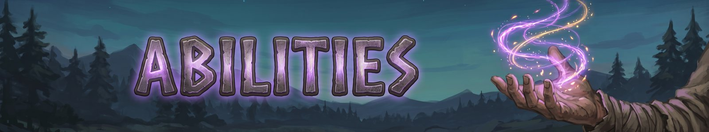
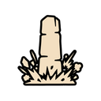

# Abilities
{: .visually-hidden}

Every ability costs eitr or stamina and has a cooldown. The element shown is the default; an element rune in the ability changes it.

## Controller

###  Binding Roots

*Common | Nature | Target (40m) | 15 eitr | 10s cooldown*

Roots a foe in place for 10s and hurts it a little while the roots hold.

###  Blinding Glare

*Uncommon | Holy | Target (40m) | 20 eitr | 20s cooldown*

Blinds a foe so its attacks often miss.

###  Dread Howl

*Uncommon | Shadow | Target (15m) | 30 stamina | 30s cooldown*

A Shadow howl that sends a foe running. Hitting it ends the fear.

###  Heavy Limbs

*Common | Frost | Target (25m) | 20 eitr | 15s cooldown*

Makes a foe move and attack slower.

###  Rune-Chain Grapple

*Uncommon | Steel | Projectile (25m) | 15 stamina | 10s cooldown*

Throws a Steel rune-chain that drags a foe to you.

###  Smother

*Rare | Frost | Target (20m) | 20 eitr | 18s cooldown*

Wraps a bubble of Frost around a foe's head so it can't act; hit the bubble to break it. The undead are blinded instead.

###  Warding Wall

*Uncommon | Earth | Ground line (10m) | 30 eitr | 25s cooldown*

Raises a Earth wall foes can't pass. Your own shots go through it.

###  Weakening Hex

*Common | Shadow | Target (40m) | 20 eitr | 30s cooldown*

Hexes a foe so it deals less damage.

###  Word of Stillness

*Common | Arcane | Target (40m) | 20 eitr | 30s cooldown*

Stuns a foe so it can't move or act.

## Healer

###  Call Back

*Epic | Holy | Fallen ally (5m), channel | 60 eitr | 600s cooldown*

Channels over an ally who fell in the last 60s to bring them back to life.

###  Mending Touch

*Common | Holy | Ally (20m) or self | 6 eitr | 6s cooldown*

Heals the target.

###  Warding Rune

*Common | Arcane | Ally (20m) or self | 8 eitr | 15s cooldown*

Shields the target from damage.

## Mage

###  Gathered Bolt

*Common | Arcane | Projectile (charged) | 4 eitr | 2s cooldown*

Hold to gather Arcane energy, then release it as one heavy bolt.

###  Rune Bolt

*Common | Arcane | Projectile | 4.5 eitr | 0s cooldown*

Launches a bolt of Arcane energy at your foes.

## Melee DPS

###  Flurry Fists

*Common | Steel | Melee | 20 stamina | 8s cooldown*

Throws a quick flurry of Steel punches. Needs bare hands or fist weapons.

###  Inner Breath

*Common | Nature | Self (hold to channel) | 10 eitr | 20s cooldown*

Hold to breathe deeply and recover stamina. You can't attack while holding.

###  Leg Sweep

*Common | Steel | Melee | 15 stamina | 12s cooldown*

Kicks your foe's legs out with a Steel sweep and knocks it back.

###  Massive Attack

*Common | Steel | Melee | 40 stamina | 15s cooldown*

Hold to wind up, then land one heavy Steel blow. The longer you hold, the harder it hits.

###  Rune Strike

*Common | Steel | Melee | 5 stamina | 8s cooldown*

Swaps one swing of your combo for a stronger Steel strike.

###  Storm Stance

*Uncommon | Lightning | Self stance (toggle) | 10 stamina | 3s cooldown*

A fast stance: you attack faster and dodge cheaper, but each hit is lighter.

###  Sudden Impact

*Uncommon | Steel | Melee | 20 eitr | 18s cooldown*

A heavy Steel blow that stuns your foe.

###  Twin Strike

*Uncommon | Steel | Melee | 20 stamina | 8s cooldown*

Hits with both weapons at once for Steel damage. Needs a weapon in each hand, or a dual weapon.

###  Warrior's Stance

*Uncommon | Steel | Self stance (toggle) | 10 stamina | 3s cooldown*

An aggressive stance: you hit harder and your statuses last longer, but you block weaker.

###  Weapon Imbue

*Common | Fire | Weapon enchant (toggle) | 20 eitr | 3s cooldown*

While on, your plain weapon attacks (not abilities) deal extra Fire damage.

###  Wolf Form

*Rare | Blood | Shapeshift (20s) | 30 stamina | 60s cooldown*

Turns you into a Blood wolf: faster, with bites that make foes bleed.

## Ranged DPS

###  Concussive Shot

*Uncommon | Steel | Projectile | 20 stamina | 15s cooldown*

A heavy Steel shot that stops your foe using ranged or magic attacks.

###  Longdraw Shot

*Common | Steel | Projectile | 15 stamina | 4s cooldown*

Tap for a quick Steel shot, or hold to charge a much stronger one.

###  Rooting Shot

*Common | Nature | Projectile | 15 stamina | 12s cooldown*

A Nature shot that roots your foe in place.

## Summoner

###  Decoy

*Uncommon | Shadow | Self (placed decoy) | 20 eitr | 30s cooldown*

Leaves a Shadow decoy that draws foes to it while you slip away.

###  Host of Spirits

*Common | Arcane | Summon (beside you) | 25 eitr | 20s cooldown*

Calls a host of Arcane spirits to fight for you for a short time.

###  Summon

*Uncommon | Earth | Pet (permanent) | 50 eitr | 3s cooldown*

Calls a Earth companion that fights beside you until you dismiss it. Element runes shape what it can do. Unique: only one can be slotted.

###  Support Totem

*Common | Steel | Ground-target totem | 25 eitr | 60s cooldown*

Plants a Steel totem that boosts everyone on your side near it.

###  Trapper's Cache

*Common | Steel | Placed trap | 20 stamina | 15s cooldown*

Sets a hidden Steel trap. The first foe to step on it takes a heavy hit and is staggered.

###  War Totem

*Common | Frost | Ground-target totem | 25 eitr | 60s cooldown*

Plants a Frost totem that shoots at foes near it.

## Support

###  Boon

*Common | Lightning | Ally (20m) or self | 20 eitr | 10s cooldown*

Gives the target a mild Lightning boost that lasts a long time.

###  Lay of Mending

*Uncommon | Holy | Song (20m, lasts 3 min) | 30 eitr | 5s cooldown*

A song that slowly heals you and your allies.

###  Leap of the Winds

*Common | Lightning | Self (jump) | 20 stamina | 8s cooldown*

Dashes you forward, or straight up if you stand still, and you fall slowly.

###  Rise

*Uncommon | Earth | Self or aimed spot (10m) | 20 eitr | 15s cooldown*

Raises a Earth pillar under your feet, or a bridge across a gap.

###  Shout

*Common | Steel | Self AoE (5m) | 25 stamina | 60s cooldown*

A war cry that gives you and nearby allies a strong, short Steel boost.

###  Skald's Refrain

*Uncommon | Holy | Song (20m, lasts 3 min) | 30 eitr | 5s cooldown*

A song that makes you and your allies regain stamina faster.

###  Well-Song of Wisdom

*Uncommon | Arcane | Song (20m, lasts 3 min) | 30 eitr | 5s cooldown*

A song that makes you and your allies regain eitr faster.

## Tank

###  Bear Form

*Rare | Nature | Shapeshift (20s) | 30 stamina | 60s cooldown*

Turns you into a Nature bear: tougher, with swipes that hit everything in front and draw foes to you.

###  Brace

*Common | Steel | Self | 20 stamina | 30s cooldown*

Reduces the damage you take, and you can't be staggered or knocked back, but you move slower.

###  Challenging Roar

*Common | Steel | Target (15m) | 20 stamina | 12s cooldown*

Roars at a foe and forces it to attack you.

###  Great-Shield Wall

*Uncommon | Steel | Self (hold block) | 15 stamina | 10s cooldown*

Hold block to raise a wall of light that guards you and allies behind you. Needs a Warfare great shield.

###  Guardian's Stance

*Uncommon | Steel | Self stance (toggle) | 10 stamina | 3s cooldown*

A defensive stance: you block harder, take less damage and strike back on perfect parries, but move slower.

###  Retribution Slam

*Rare | Earth | Melee | 35 stamina | 25s cooldown*

Turns part of the damage you've blocked recently into a Earth blow on a foe.

###  Riposte

*Uncommon | Steel | Self (parry window) | 15 stamina | 8s cooldown*

Opens a short parry window. Block a hit in it to counter hard and get stamina back.

###  Shield Bash

*Common | Steel | Melee | 15 stamina | 6s cooldown*

Bashes your foe with your shield, staggering it and forcing it to attack you.

## Signature abilities

There are 35 signature abilities. The first time you beat a boss, you choose its signature ability or its trophy rune; the other is lost for that character. Signatures are your strongest abilities, take no runes and show in gold.

> **More to come: Signature abilities**
> What each one does is a surprise. Choose with care.

---
*Fate Woven is designed by a human, who decides what it does and how it plays. The code is written by Claude, an AI model made by Anthropic, working from that design. The documentation is written by Claude too, and the icons are AI-generated.*
