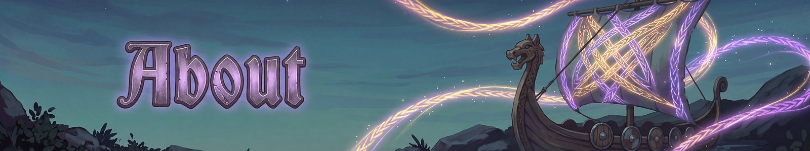

# About
{: .visually-hidden}

Fate Woven is designed by a human, who decides what it does and how it plays. The code is written by Claude, an AI model made by Anthropic, working from that design. The documentation is written by Claude too, and the icons are AI-generated.

Every game decision, such as which abilities exist, what the runes do and how it is balanced, comes from the human designer. If something reads wrong or plays wrong, please report it, and a person reads the reports.

## Built on
Fate Woven is built on [BepInEx](https://github.com/BepInEx/BepInEx) and [Jotunn](https://github.com/Valheim-Modding/Jotunn). Thanks to their authors, and to the wider Valheim modding community. The [Companion mods](companion-mods.md) page lists the mods we have tested with it.

## Find us
- Guide: this site.
- Chat, share builds and get help: [Discord](https://discord.gg/hzQgdjk7w3).
- Bugs and ideas: the [issues page](https://github.com/processq/fate-woven-issues/issues/new/choose). You need a free GitHub account.
- Download: [Hexium](https://valheim.hexium.gg/mods/processq/FateWoven) and [GitHub releases](https://github.com/processq/fate-woven-issues/releases).

---
*Fate Woven is designed by a human, who decides what it does and how it plays. The code is written by Claude, an AI model made by Anthropic, working from that design. The documentation is written by Claude too, and the icons are AI-generated.*
