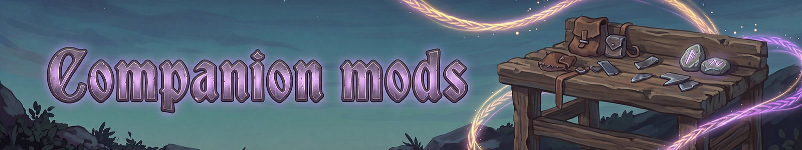

# Companion mods
{: .visually-hidden}

<b>Mods we tested with Fate Woven</b>

**Fate Woven's later game is balanced around [Creature Level and Loot Control](https://thunderstore.io/c/valheim/p/Smoothbrain/CreatureLevelAndLootControl/) (CLLC).** Fate Woven never changes enemies, so on plain Valheim it will feel easy. An enemy-scaling mod such as CLLC gives the late game its challenge, and we recommend using one.

Fate Woven works with the mods below. For each one we checked that it loads with no errors, the charm slot works and your pets come back after loading, plus the extra things listed. If something clashes, please tell us (see Reporting bugs).

* **[SeneaL UI](https://thunderstore.io/c/valheim/p/seneaL/SeneaL_UI/) and [SeneaL API](https://thunderstore.io/c/valheim/p/seneaL/SeneaL_API/):** Works. Our ability bar, level line, pet window and panels show up in its layout, and our shield appears as its "Shield" chip. Fate Woven adds its buttons to its character panel and adopts its look for some bars and buttons.
* **[Path of Valheiman](https://thunderstore.io/c/valheim/p/treextr/PathOfValheiman/) 5.3.4:** Works, solo and with friends (the two together are not balanced; see Known issues). Fate Woven ignores its skill changes so your ability damage is not cut. Your Fate Woven pets count as your pets to it, so its pet nodes make them stronger too. With it installed, the Fate Woven Party window opens with O instead of P, and its level is the one level: Fate Woven's own level is hidden, its drafts come as your Path of Valheiman level rises, and Fate Woven's XP rewards go to it. Re-weave and Hel's Road are not available with it, since a new run can't reset its level.
* **[Valheim Community Patch](https://thunderstore.io/c/valheim/p/MidnightMods/ValheimCommunityPatch/) 0.40.0:** Works. Shields and eitr (including the reserve for pets) were checked in detail.
* **[Epic Loot](https://thunderstore.io/c/valheim/p/RandyKnapp/EpicLoot/):** Works. Quest rewards from Epic Loot include Therzie's Warfare gear when both are installed.
* **[Creature Level and Loot Control](https://thunderstore.io/c/valheim/p/Smoothbrain/CreatureLevelAndLootControl/) (CLLC):** Works. Use a current 5.x version.
* **[Star Level System](https://thunderstore.io/c/valheim/p/MidnightMods/StarLevelSystem/):** Works.
* **[Monstrum](https://thunderstore.io/c/valheim/p/Therzie/Monstrum/), [Warfare](https://thunderstore.io/c/valheim/p/Therzie/Warfare/), [Wizardry](https://thunderstore.io/c/valheim/p/Therzie/Wizardry/) and [Armory](https://thunderstore.io/c/valheim/p/Therzie/Armory/):** Work.
* **[Equipment and Quick Slots](https://thunderstore.io/c/valheim/p/RandyKnapp/EquipmentAndQuickSlots/) and [ExtraSlots](https://thunderstore.io/c/valheim/p/shudnal/ExtraSlots/):** Work. With Equipment and Quick Slots, its Legs and Trinket row peeks out a little under our top buttons.
* **[HP Barheim](https://thunderstore.io/c/valheim/p/DarthVladi/HP_Barheim/):** Works.
* **[Groups](https://valheim.hexium.gg/mods/Smoothbrain/Groups):** Works. With Groups, Fate Woven shows no party UI of its own; your Groups group is your party for trades, group quests, shared XP and Fellowship. Its group-ping modifier and our self-cast are both Left Alt by default.
* **[ImmersiveTrader](https://valheim.hexium.gg/mods/Hypnogoogic/ImmersiveTrader) 1.4.0:** Works. A server can list Fate Woven Charms in a trader's shop (you can still wear only one). Its Quest Log and our pet order key are both J by default; Fate Woven shows a message once so you can rebind one.
* **[Marketplace and Server NPCs](https://valheim.hexium.gg/mods/KG/Marketplace_And_Server_NPCs_Revamped) 10.0.8:** Works. Server quests can give Fate Woven rewards with the `fw_reward` command and check a player's Fate Woven level, Charm tier and Re-weave count.
* **[Vikings Magic](https://valheim.hexium.gg/mods/Radamanto/Vikings_Magic) 1.2.1 and [Roots & Remedies](https://valheim.hexium.gg/mods/Hypnogoogic/Plant_Craft_Cook_RootsAndRemedies) 1.1.9:** Load and play with Fate Woven.
* **[MinimalStatusEffects](https://thunderstore.io/c/valheim/p/RandyKnapp/MinimalStatusEffects/), [ZenUI](https://thunderstore.io/c/valheim/p/ZenDragon/ZenUI/) and [MyLittleUI](https://thunderstore.io/c/valheim/p/shudnal/MyLittleUI/):** Work together. Our HUD is unchanged and our shield shows as a chip.

## Keys that clash

Some of Fate Woven's default keys are also used by other mods. Both do their job at once, so the game shows a message listing the clashes the first time. Our defaults stay; rebind either side in the config (Fate Woven: Keys).

| Our key | What it does | Also used by |
|---|---|---|
| Z | Cast | SeneaL UI (quick slot 1), Equipment and Quick Slots (quick slot 1) |
| B | Wheel | Equipment and Quick Slots (quick slot 3) |
| H | Pet mode | SeneaL UI (quick-slot toggle), Epic Loot (Ability Hotkey 2) |
| J | Pet order | Epic Loot (Ability Hotkey 3), ImmersiveTrader (Quest Log; Fate Woven shows a message when both are on J) |
| Left Alt | Self-cast | drag and lock keys in Equipment and Quick Slots, ExtraSlots, Quick Stack, ZenUI and MyLittleUI, Epic Loot (Trader Panel Drag Key), and Groups (group-ping modifier) |

## Suggested settings

Fate Woven makes you stronger than plain Valheim, so with nothing else installed most fights feel a little easier than vanilla. If you want them a bit harder than vanilla (about a quarter harder at each biome), these settings get close. *Worked out from each mod's default settings, 2026-11-08; not yet tested in play.*

| You have | Set this | Leave the rest at default |
|---|---|---|
| Creature Level and Loot Control | `2 - Creatures / Difficulty` = **Hard** | Fights are a bit harder early on; by the late biomes they drift back toward vanilla. |
| Creature Level and Loot Control and Path of Valheiman | the above, and Path of Valheiman's `Difficulty preset` = **1** (Easy) | About a quarter harder than vanilla at every biome. Its default (Normal) is much harder from the Mountains on. |
| Epic Loot | nothing | Its gear makes you a little stronger (at most +5 to 10% weapon damage and +8 to 12% armor at Legendary); it never changes creatures. |

Creature Level and Loot Control Extended adds random modifiers to most creatures on top of this, so with it installed, you may prefer Creature Level and Loot Control on its default difficulty.

---
*Fate Woven is designed by a human, who decides what it does and how it plays. The code is written by Claude, an AI model made by Anthropic, working from that design. The documentation is written by Claude too, and the icons are AI-generated.*
