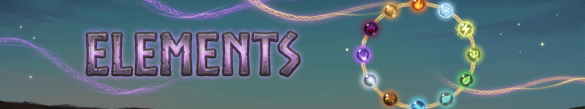

There are twelve elements. Each fits a role, but you can mix them.

| Role | Elements |
|---|---|
| Tank | Earth, Steel, Frost |
| Healer | Nature, Water, Blood |
| Support | Arcane, Lightning, Holy |
| Damage | Fire, Shadow, Poison |

##  Arcane

Status: **None (Spellbound is applied only by the Arcane riders and cards that name it)**. None: Arcane has no element bonus beyond its role and kind riders.

##  Blood

Status: **Bleeding**. Hits apply Bleeding: 40% of the hit over 6s, doubled while the target moves. Abilities may be paid with 1 HP per 1 stamina/eitr of cost when you lack the resource.

##  Earth

Status: **Staggered -> Petrified**. Hits deal heavy stagger. An enemy Staggered twice within 6s by Earth hits (anyone's) is Petrified for 2s, then immune 10s. Against stagger-immune creatures (bosses, fliers, Blobs and the like) the stagger parts do nothing; the damage stays.

##  Fire

Status: **Burning**. Hits apply Burning: 30% of the hit as Fire damage over 5s; re-applying refreshes and adds 10% (max 60%). On Wet targets Burning lasts half as long and clears Wet. Valheim's own Wet behaviour toward fire (it reduces fire damage) is left as vanilla.

##  Frost

Status: **Chilled -> Frozen**. Hits add 1 Chilled (+8% cast time per stack, max 5, 6s). Vanilla's own Frost slow, which these hits start, is Frost's movement slow; Chilled adds none of its own. At 5 stacks the target is Frozen for 2s (bosses: slowed 50% for 2s instead), then immune to Frozen for 8s.

##  Holy

Status: **Marked**. Hits apply Marked for 8s: it takes 10% more damage from Fate Woven ability hits (there are no crits; matches the Marked status and the code), and allies hitting it heal 2% of damage dealt. Holy hits remove Cursed from allies they pass through.

##  Lightning

Status: **Shocked**. Hits apply Shocked for 6s: the next hit on a Shocked enemy deals +20% damage and arcs 50% of it to 1 enemy within 6m, consuming Shocked. Wet targets take x1.5 Lightning damage.

##  Nature

Status: **Rooted**. Hits Root the target for 1.5s (bosses: slowed 40% instead), then immune 6s. Allies near Nature effects regenerate 1% max HP/s while within 3m of a planted zone, totem or summon.

##  Poison

Status: **Venom**. Hits add 2 Venom (max 10, 8s): each stack deals 2.5% of the hit as Poison damage a second and reduces healing received by 3%; on Poison-immune creatures the stacks land with 0 damage. At 10 stacks the target also deals 10% less damage.

##  Shadow

Status: **None (Cursed is applied only by the cards that name it)**. About 4 times a minute, a kill with a Shadow ability makes every enemy within 8m lose track of you and Stealths you for 3s, so your next Shadow hit on an enemy that hasn't been sneak-attacked yet is a x6 sneak attack.

##  Steel

Status: **Bleeding (Slash/Pierce) or Staggered (Blunt), and Sundered on every hit**. Default with no Element Rune. +10% damage and +15% stagger; Slash/Pierce hits apply a light Bleeding (20% of the hit over 4s), Blunt hits deal +30% stagger. Steel pierces: projectiles and beams pass through 2 more enemies, each taking 15% less than the last (a beam reaches every target on its straight line at full strength, heals too); everything else ignores the target's physical resistances (resistant counts as normal). Every Steel hit also Sunders the target: its physical resistances ease 15% for everyone else's hits too, since Steel's own melee already ignores them. No elemental weakness or status-combo interactions.

##  Water

Status: **Wet**. Hits apply Wet for 12s (native Valheim Wet: -stamina regen) and push enemies 2m. Wet enemies take x1.5 Lightning and Frost (vanilla's Wet) and Frost hits add 1 extra Chilled (as the Wet status says); Fire on Wet consumes Wet for a steam burst (20 dmg, 3m).

---
*Fate Woven is designed by a human, who decides what it does and how it plays. The code is written by Claude, an AI model made by Anthropic, working from that design. The documentation is written by Claude too, and the icons are AI-generated.*
