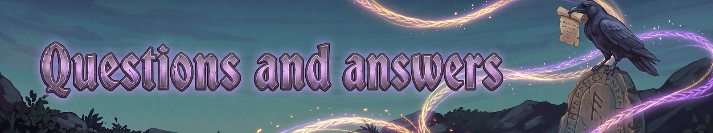

# Questions and answers
{: .visually-hidden}

## How do I install Fate Woven?

Use your mod manager (r2modman or similar). It installs BepInEx and Jotunn for you.

To install by hand, put BepInExPack_Valheim and Jotunn in place first, then copy the plugins/FateWoven folder from the download into BepInEx/plugins. Start the game once so the config file is created.

## Do the other players need the mod too?

Yes. Everyone who joins a game, and the server if there is one, needs the same version of Fate Woven. A different version will not join. The host's server settings are shared with everyone who joins.

## How do I get started?

Fight. Every kill gives XP, and every level offers three cards: pick one. The first levels offer abilities, which go on your bar.

K opens the Runes panel. Z casts the readied ability. Hold B for the ability wheel, or press [ and ] to step through the bar. H and J control your pets.

The Fate Woven guide at https://fatewoven.net/ explains the rest.

## Why won't my rune go into an ability?

A rune is greyed out for one of two reasons, and its tooltip says which.

First, every copy of that rune is already socketed in another ability. The tooltip names the ability that holds it. Take it out there first.

Second, the rune does not fit that ability. Some runes only work with certain kinds of ability, and some pairs do nothing together, so they are left out on purpose.

## Where is the config file?

BepInEx/config/FateWoven.cfg. It is created the first time you run the game with the mod.

Most settings are server settings. On a server, only the host's file matters, and everyone who joins uses the host's values.

## Is it safe to use on my real save?

This is a beta, so back up your character and world before you try it. The files are in Valheim's saves folder, under characters_local and worlds_local. If anything goes wrong, copy them back.

## How do I report a bug or share an idea?

Open an issue at https://github.com/processq/fate-woven-issues/issues and pick "Report a bug" or "Idea". Please include your Fate Woven version and what you were doing. If it helps, set General > Logging to Detailed in the settings, play until it happens again, and attach BepInEx/LogOutput.log.

A bug that can be reproduced gets fixed. Balance and design feedback is read and weighed.

## Who made Fate Woven? Is it AI?

Fate Woven is designed by a human, who decides what it does and how it plays. The code is written by Claude, an AI model made by Anthropic, working from that design. The documentation is written by Claude too, and the icons are AI-generated.

Every game decision, such as which abilities exist, what the runes do and how it is balanced, comes from the human designer. If something reads wrong or plays wrong, please report it, and a person reads the reports.

## Where can I chat, get help or share builds?

Join the Fate Woven Discord: https://discord.gg/hzQgdjk7w3

There are channels for help, suggestions, builds and spoilers. Please still put bugs on GitHub (https://github.com/processq/fate-woven-issues/issues/new/choose), so they are not lost.

---
*Fate Woven is designed by a human, who decides what it does and how it plays. The code is written by Claude, an AI model made by Anthropic, working from that design. The documentation is written by Claude too, and the icons are AI-generated.*
