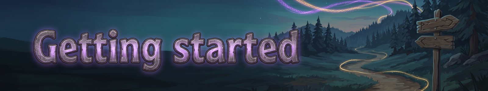
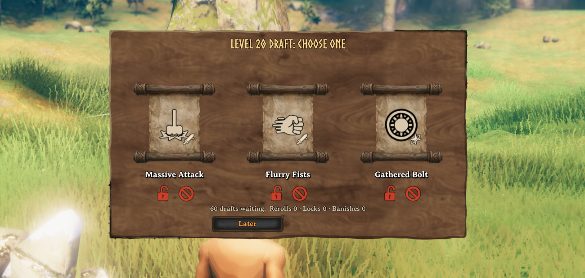
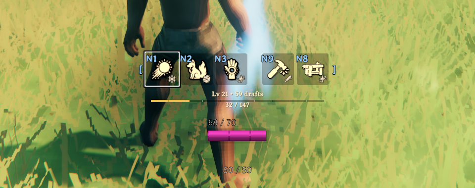

# Getting started
{: .visually-hidden}

### The Idea

Fate Woven gives you spells. Fight to earn XP, and every level offers you three cards to pick from. Abilities go on your bar. Runes slot into abilities and change how they work. Out of combat, you can swap either whenever you like.

### Levels And Drafts

Levels 1 to 3 offer abilities only. After that, even levels offer runes and odd levels offer abilities. Utility abilities start at level 11, and the top level is 60. Beat a boss and you get a draft of strong runes. You can own the same ability twice, and each copy keeps its own runes.

### Keys

K: open the Runes panel.  
Z: cast your readied ability.  
Hold B: open the ability wheel. Or step through your bar with [ and ].  
H: pet mode. J: pet orders.  
Escape or jump: stop a channel.  
You can change every key in the config.

### The Bar

You start with three combat slots and get another at levels 10, 25 and 40. You also have two utility slots, and utility abilities fit only there. Abilities cost eitr or stamina and have a cooldown. Eitr is the pink bar, with its numbers on it, and every tooltip shows what an ability costs and what you have. A red icon means you can't pay right now, and it shows how much you need. A cast that hits nothing costs nothing. Some abilities are channels: you stand still while they run, but you can still turn and aim.

### Eitr And Mastery

Eitr comes back faster out of combat. Each ability builds mastery the more you use it, which makes it stronger up to a limit. Costs never go up as you grow.

### Signatures

The first time you beat a boss, you choose between its signature ability and its trophy rune. You lose the other one for that character. Signatures are your strongest abilities. They take no runes and show in gold.

### Damage

Everything you deal is split by element, each in its own colour. A dimmed number was resisted, and a bold one hit a weakness. Two settings under Visuals change this for you only: Split damage numbers (one number per element, or one total) and Damage numbers (off hides them all). Your abilities also break what a weapon would break, like beehives and pots, but not buildings, rock, ore or trees.

### Runes

Each ability has an element slot, a few normal slots, an Epic slot and a Legendary slot. Runes of the same element stack: about +20% in a normal slot, +25% in the Epic slot and +30% in the Legendary slot. Epic and Legendary runes also change how an ability plays, and they break an enemy's resistance to their element for a few seconds.

### Sets And Special Runes

Carry several pieces of a rune set to earn its bonuses. Sworn runes tie an element to a god. Meta runes change how your other runes work.

### When cards open up

Cards open by character level, not by boss kills, so a player who levels fast still sees everything. Abilities, runes and blessings open in tiers:

| Biome tier | Opens at level |
|---|---|
| Meadows | 1 |
| Black Forest | 5 |
| Swamp | 12 |
| Mountains | 20 |
| Plains | 28 |
| Mistlands | 36 |
| Ashlands | 45 |
| Deep North | 53 |

A few abilities are held back until a higher level on top of that (Summon Mount opens at level 30).

*A draft: three cards, pick one.*

*Your ability bar.*

### Only one of a kind

- **Unique abilities:** Summon can be in only one bar slot at a time. You can own several Summons with different runes and swap which one is slotted.
- **One-per-group runes:** some runes belong to a group, and you can have only one from each group. **Shape:** Cone, Nova, Beam and Downpour, one per ability. **Path:** Drifting, Zigzag and Wild Path, one per ability. **Cost change:** Kindred Blood and Duelist's Focus, one per ability. **Trigger:** one Trigger rune on your whole bar. A second one will not socket, and the socket tells you why.

---
*Fate Woven is designed by a human, who decides what it does and how it plays. The code is written by Claude, an AI model made by Anthropic, working from that design. The documentation is written by Claude too, and the icons are AI-generated.*
