# Gods and blessings
{: .visually-hidden}

Please the gods with deeds and offerings to earn blessings. Blessings are passive powers and never take an ability slot. Two gods' blessings can pair into a duo.

There are 74 Epic and Legendary blessings. They are left for you to discover in play.
There are 22 duo blessings. They are left for you to discover in play.

> **More to come: Epic, Legendary and duo blessings**
> Each god keeps its stronger blessings back until you have earned their favour.
> Win favour two gods at once and their blessings can pair into a duo that works only when both are active.
> Every god has one rival, and the gods' favour pulls against theirs.

| God | Domain | Elements | Rival |
|---|---|---|---|
| Odin | Wisdom, war, death, spell-song and the chosen slain | Arcane, Shadow | Thor |
| Thor | Thunder, strength, protection of Midgard | Lightning, Steel | Odin |
| Tyr | Law, oaths, single combat and sacrifice | Steel, Blood | Bragi |
| Heimdall | Watchfulness, the rainbow bridge, warning | Holy, Arcane | Loki |
| Vidar | Silence, vengeance, endurance through the end | Earth, Steel | Idunn |
| Ullr | The hunt, archery, skis, winter travel | Frost, Nature | Freyr |
| Skadi | Mountains, winter, hunting, vengeance | Frost, Nature | Njord |
| Bragi | Poetry, eloquence, the mead of poets | Holy, Arcane | Tyr |
| Freyja | Love, magic magic, the battle-slain of Folkvang | Arcane, Holy | Frigg |
| Frigg | Queenship, foreknowledge, hearth and protection | Holy, Water | Freyja |
| Loki | Trickery, shape-shifting, fire and ruin | Fire, Poison, Shadow | Heimdall |
| Njord | Sea, wind, seafaring and plenty | Water | Skadi |
| Freyr | Harvest, sunlight, rain and peace | Nature, Holy | Ullr |
| Hel | Rule of the dead and Hel's realm | Shadow, Frost | Baldr |
| Baldr | Light, purity and renewal | Holy, Fire | Hel |
| Idunn | Youth, renewal and the apples of the gods | Nature, Holy | Vidar |
| Aegir | The sea's depths, storms at sea, brewing and the feast | Water, Fire | Loki |

## Odin

*Wisdom, war, death, spell-song and the chosen slain.* Favour comes from: Killing elites and bosses; spending eitr; discovering new locations, runestones and vegvísirs; dying with honor (killed by a boss). Offerings: Mead, boss trophies, fine wood, dragon tears.

- 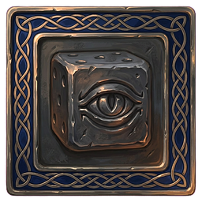 **All-Seer's Wager** (Common): Your ability hits often restore eitr, twice as much on Marked foes.
- 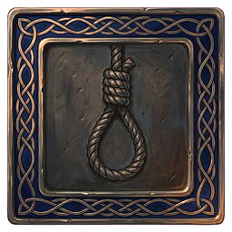 **Stillness of the Hanged** (Common): Standing still makes your cooldowns tick 10% faster and slowly restores eitr.
- 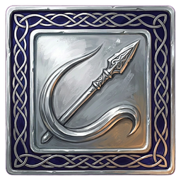 **Spear Over the Host** (Rare): Your first hit on a starred foe or boss Marks and Curses it, and you deal 10% more damage to them.
- 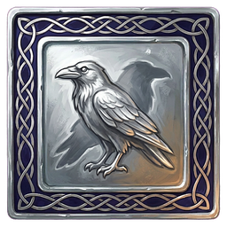 **Twin Raven Echo** (Rare): Abilities have a 6% chance to cast again at their normal cost; each echo heals you.
- *6 more blessings to find, and 5 duos shared with another god.*

## Thor

*Thunder, strength, protection of Midgard.* Favour comes from: Kills with lightning, maces or sledges; slaying giant-kin (Trolls, Fulings, Jötunn foes); staggering enemies. Offerings: Mead, troll trophies, iron, roasted meats.

- 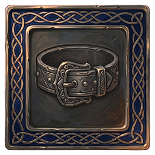 **Belt of Doubled Might** (Common): Your Lightning deals 8% more damage, and Staggered foes take more from all your hits.
- 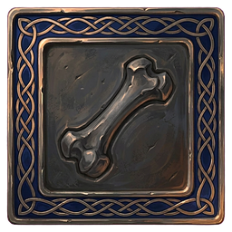 **Goat-Bone Feast** (Common): Raises your max HP by 20; eating heals you and makes you harder to Stagger.
- 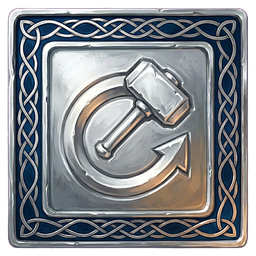 **Hammer Homecoming** (Rare): Heavy mace and sledge attacks sometimes hurl a spectral hammer that bursts with Lightning, then flies back.
- 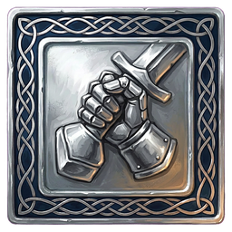 **Iron-Gloved Grip** (Rare): About 6 times a minute, a melee hit knocks back and Staggers; blocking chains Lightning to nearby foes.
- *4 more blessings to find, and 5 duos shared with another god.*

## Tyr

*Law, oaths, single combat and sacrifice.* Favour comes from: Defeating enemies one-on-one; parrying; finishing fights without fleeing; dealing damage while below half HP. Offerings: Wolf trophies, Fenring trophies, silver, bronze.

- 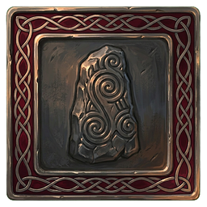 **Law of the Thing** (Common): Enemies that hit you are Marked, and you deal 10% more damage to foes targeting you.
- 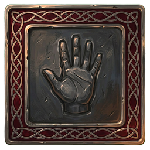 **Pledge-Hand** (Common): Parrying grants 12% more damage briefly, and you take less damage when facing a lone foe.
- 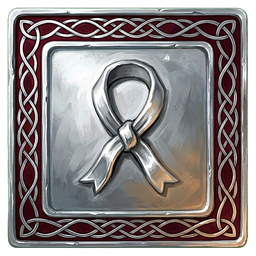 **Fetter-Binder** (Rare): Perfect parries Root the attacker, and Rooted foes take 15% more Bleeding damage from you.
- 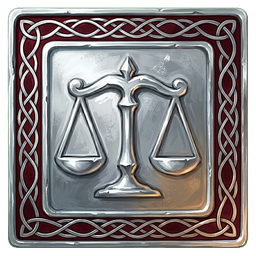 **Price of the Oath** (Rare): Below half HP you deal 15% more damage and steal life; near full HP your hits cause Bleeding.
- *4 more blessings to find, and 2 duos shared with another god.*

## Heimdall

*Watchfulness, the rainbow bridge, warning.* Favour comes from: Spotting and killing enemies before they reach you; defending your base from raids; standing watch at night; climbing heights. Offerings: Horns (Lox/Deer/Drake), amber, crystals, mead.

- 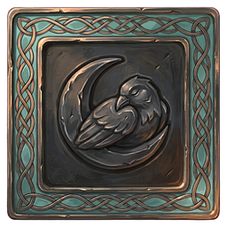 **Bird-Light Slumber** (Common): Rested lasts 25% longer, and you take less damage at night.
- 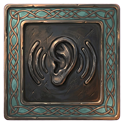 **Ear for Growing Grass** (Common): While crouched or still, you see nearby enemies outlined, and you deal 10% more damage to unaware foes.
- 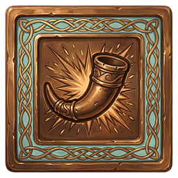 **Gjallarhorn's Warning** (Uncommon): When a raid or elite draws near, a horn sounds and points the way; you and your allies gain 20 armour briefly.
- 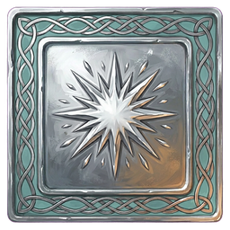 **Bridgeward's Flare** (Rare): Dodging through an enemy leaves a band of prismatic light that sears foes with Holy damage and Chills them.
- 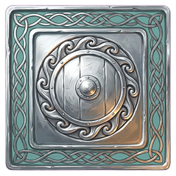 **Nine-Mothered Guard** (Rare): Every 20s, if you have no other Shield, you gain one; while it holds, enemies that strike you are Marked.
- *5 more blessings to find, and 2 duos shared with another god.*

## Vidar

*Silence, vengeance, endurance through the end.* Favour comes from: Kicks and unarmed hits; avenging (killing what downed an ally or Summon); surviving at low HP; slaying wolves. Offerings: Leather scraps, wolf pelts, deer hide, troll hide.

- 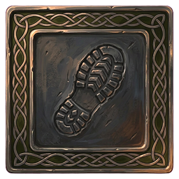 **Silent Tread** (Common): Sneaking is quieter, and your first hit from Stealth deals 15% more damage and Staggers.
- 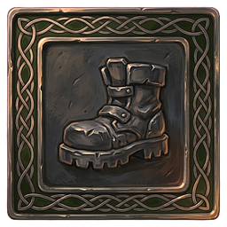 **Thick-Soled Stride** (Common): Kicks and Unarmed hits deal 12% more damage, and knockback moves you less.
- 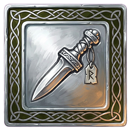 **Avenger's Debt** (Rare): When an ally or your Summon falls nearby, its killer is Marked and takes 25% more damage from you.
- 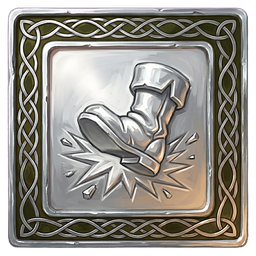 **Jaw-Splitter** (Rare): Kicks on Staggered or Rooted foes deal 30% more damage and cause Bleeding; every kick heals you.
- *4 more blessings to find, and 2 duos shared with another god.*

## Ullr

*The hunt, archery, skis, winter travel.* Favour comes from: Bow and thrown kills; long-range headshots; hunting animals; travelling far across snow. Offerings: Deer trophies, feathers, fine wood, wolf pelts.

- 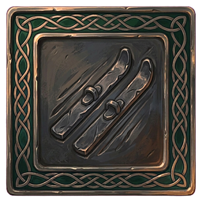 **Snowfield Glide** (Common): You move 12% faster on snow and ice, and running costs no stamina while you wield a bow.
- 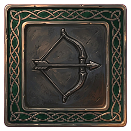 **Yew-Hall Draw** (Common): You draw bows 8% faster, and fully drawn shots hit harder and Chill.
- 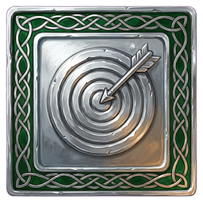 **Hunter Without Peer** (Rare): Your first hit on each foe Marks it; Bow and Thrown attacks deal 15% more damage to Marked foes.
- 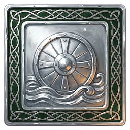 **Shield-Ship Crossing** (Rare): Blocking with a shield sometimes grants a Frost Shield; while Shielded, your arrows pierce an extra enemy.
- *4 more blessings to find, and 1 duo shared with another god.*

## Skadi

*Mountains, winter, hunting, vengeance.* Favour comes from: Fighting in cold biomes; killing with Frozen or Chilled; hunting with bows and traps; climbing mountains. Offerings: Wolf and Drake trophies, freeze glands, obsidian, wolf pelts.

- 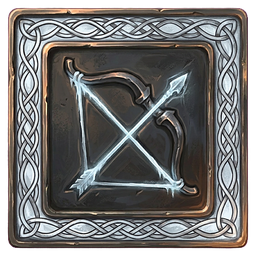 **Bowstring of the High Mountain** (Common): Bow hits on Chilled foes deal 12% more damage, and Frozen foes take more from your Thrown weapons.
- 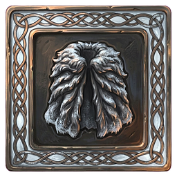 **Hoarfrost Mantle** (Common): You take 8% less damage, are immune to Cold, resist Freezing, and take less Fire and lava damage.
- 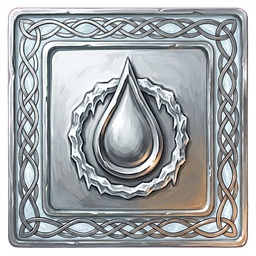 **Cold-Blooded Rally** (Rare): Below 40% HP, your cooldowns run faster and your Frost hits deal more damage.
- 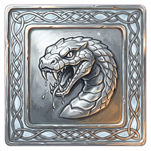 **Serpent's Drip** (Rare): Your traps and Roots also apply Venom and Chill.
- *4 more blessings to find, and 3 duos shared with another god.*

## Bragi

*Poetry, eloquence, the mead of poets.* Favour comes from: Using Shouts; buffing allies; feasting together; telling of deeds (completing biome bosses with others nearby). Offerings: Meads, honey, feasts, raspberries/blueberries.

- 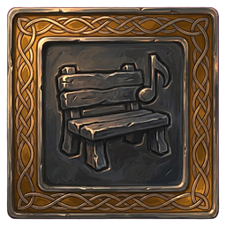 **Bench-Song** (Common): Eating near allies raises everyone's max stamina; while Rested, you receive more healing.
- 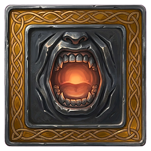 **Rune-Carved Tongue** (Common): Shout cooldowns are 10% shorter, and your Shouts heal you and your allies nearby.
- 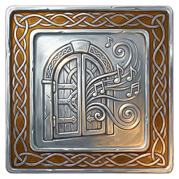 **Hall-Filling Verse** (Rare): Inspired you grant lasts 30% longer, and those you Inspire also heal 10% more.
- 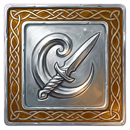 **Sharp Retort** (Rare): Enemies that hit you are often Cursed, so they deal less damage.
- *5 more blessings to find, and 2 duos shared with another god.*

## Freyja

*Love, magic magic, the battle-slain of Folkvang.* Favour comes from: Kills while Inspired; casting eitr spells; reviving or healing fallen allies. Offerings: Amber, honey, mead, gold coins.

- 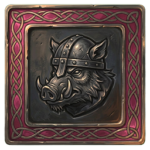 **Battle-Swine's Bounty** (Common): Food health regen heals 20% more, and eating in combat makes you Inspired.
- 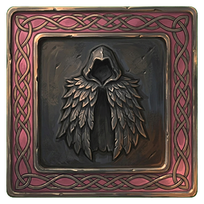 **Falcon-Feather Cloak** (Common): Dodge rolls go 15% farther, you can glide while falling, and fall damage is reduced.
- 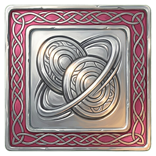 **Freyja's Necklace Discs** (Rare): Two golden discs orbit you, dealing Arcane damage and Staggering light enemies; being Inspired adds a third.
- 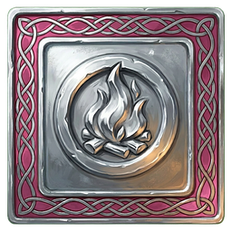 **Hearth Ring of Magic** (Rare): A magic ring surrounds you, healing you while foes inside take Arcane damage and are slowly Cursed.
- *6 more blessings to find, and 3 duos shared with another god.*

## Frigg

*Queenship, foreknowledge, hearth and protection.* Favour comes from: Blocking or parrying hits near allies; healing allies; resting Rested by a hearth. Offerings: Linen thread, flax, honey, bread.

- 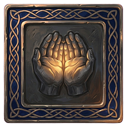 **Protector's Shelter** (Common): Perfect blocks Shield you and the nearest ally.
- 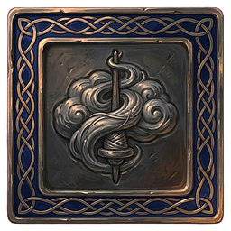 **Spindle of Clouds** (Common): Rested lasts 30% longer; while Rested, the first hit you take every so often is halved.
- 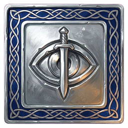 **Foreknown Blow** (Rare): Every 12s, the next foe about to strike you in melee is Marked first; parrying it Staggers it and makes you Inspired.
- 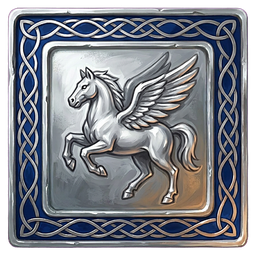 **Messenger's Errand** (Rare): Your Heals speed up the healed target and cleanse Rooted and Wet.
- *4 more blessings to find, and 1 duo shared with another god.*

## Loki

*Trickery, shape-shifting, fire and ruin.* Favour comes from: Kills from Stealthed; igniting Venomed foes; enemies slain by traps, falls or each other. Offerings: Surtling cores, fish, ooze.

- 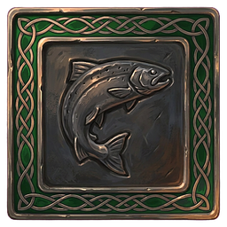 **Salmon-Shape Slip** (Common): You have a 12% chance to fully evade any hit, but blocking costs more stamina.
- 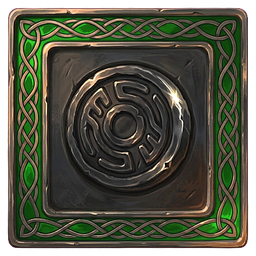 **Silver Tongue's Price** (Common): Attacks from Stealth deal 40% more damage, but whenever an enemy spots you, you take 10% more damage for 4s.
- 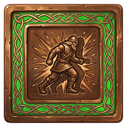 **Trickster's Shadow** (Uncommon): About 6 times a minute, your dodge leaves a decoy that nearby enemies chase.
- 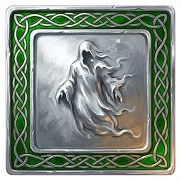 **False Shapes** (Rare): Every 20s in combat, two illusions of you join the fight and draw attacks, then burst to Blind foes.
- 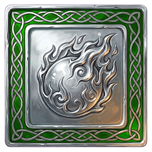 **Marsh-Gas and Wildfire** (Rare): Dodging leaves a trail of marsh-gas that adds Venom; Fire ignites it in a burst that can hurt you too.
- 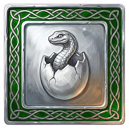 **Wolf-Mother's Brood** (Rare): Kills spawn vipers that fight for you and add Venom; each living viper lowers your max HP.
- *4 more blessings to find, and 4 duos shared with another god.*

## Njord

*Sea, wind, seafaring and plenty.* Favour comes from: Sailing; fishing; fighting while Wet; slaying sea creatures. Offerings: Fish, serpent scales, serpent meat, chitin.

- 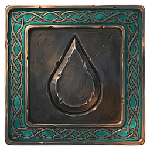 **Calmer of Flame** (Common): While Wet you can't Burn; striking a Burning foe while Wet douses it with bonus Water damage.
- 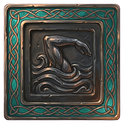 **Swimmer's Ease** (Common): Swimming costs 25% less stamina and is faster, and being Wet no longer slows your stamina regen.
- 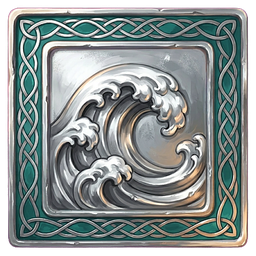 **Breaking Tide** (Rare): About 20 times a minute, a melee hit sends a wave forward, knocking foes back and making them Wet.
-  **Rain-Rich Shores** (Rare): In water or rain, you deal 15% more damage and take less.
- *4 more blessings to find, and 3 duos shared with another god.*

## Freyr

*Harvest, sunlight, rain and peace.* Favour comes from: Planting and harvesting crops; taming and breeding animals; fighting without a sword. Offerings: Carrots, turnips, barley, boar trophies.

-  **Bristles of Gold** (Common): Tamed animals and Summons near you deal 20% more damage and glow, lighting the area.
-  **Harvest-Lord's Step** (Common): Crops and saplings near you grow 50% faster, and harvesting boosts your stamina regen.
-  **Rain on Ripe Barley** (Common): Food health regen is 20% stronger, and you regenerate health in the rain.
-  **Beli's Bane** (Rare): Attacks with anything but a sword deal 20% more damage and sometimes Stagger.
-  **Elf-Home Daybeam** (Rare): Every 6s, a sunbeam strikes the nearest foe with Holy damage and may set it Burning.
- *4 more blessings to find, and 3 duos shared with another god.*

## Hel

*Rule of the dead and Hel's realm.* Favour comes from: Slaying undead; killing Cursed or Venomed foes; surviving at low health. Offerings: Bone fragments, draugr trophies, withered bone, entrails.

-  **Half-Blue Visage** (Common): Undead deal 15% less damage to you, and your hits often Curse them.
-  **Hel's Dish** (Common): Killing a Cursed enemy heals you for 4% of your max HP.
-  **Hel's Sickbed** (Rare): Enemies you Stagger are Cursed.
-  **Toll of the Hel Bridge** (Rare): Hitting a lesser foe below 8% HP slays it outright and briefly Shields you.
- *4 more blessings to find, and 2 duos shared with another god.*

## Baldr

*Light, purity and renewal.* Favour comes from: Fighting in daylight; healing allies; winning fights without taking damage. Offerings: Dandelions, honey, mead, thistle.

-  **Broad-Gleaming Hall** (Common): Heals you cast on others also heal you for 30% of the amount.
-  **Whitest Blossom** (Common): In daylight you regenerate health and take 5% less damage.
-  **Hringhorni's Pyre** (Rare): When an ally or Summon dies nearby, it bursts into Burning pyre-flame and you heal.
-  **Shafts Thrown in Sport** (Rare): Projectiles have a 20% chance to glance off you, each granting Radiance for more Holy damage.
- *4 more blessings to find, and 2 duos shared with another god.*

## Idunn

*Youth, renewal and the apples of the gods.* Favour comes from: Eating food; keeping allies above half health; foraging berries and mushrooms. Offerings: Raspberries, blueberries, cloudberries, honey.

-  **Bite of Youth** (Common): Eating heals you instantly and boosts your stamina regen for a minute.
-  **Eski of Unfading Fruit** (Common): Food lasts 20% longer before fading, and eating cleanses one harmful status.
-  **Evergreen Vigor** (Rare): Raises your max stamina by 15, and your stamina regen is higher while you're healthy.
-  **Nut-Shell Refuge** (Rare): Falling below 25% HP encases you in a shell that briefly makes you invulnerable and heals you.
- *4 more blessings to find, and 2 duos shared with another god.*

## Aegir

*The sea's depths, storms at sea, brewing and the feast.* Favour comes from: Sailing in storms; slaying sea creatures, the Sea Serpent above all; hosting feasts (eating together with allies); brewing mead. Offerings: Mead, serpent scales, serpent meat, fish.

-  **Brewer's Gift** (Common): Meads you drink last 50% longer.
-  **Salt-Weathered** (Common): On a boat, your stamina regen is 20% higher and your boat takes less damage.
-  **Feast-Host** (Rare): When you eat, nearby allies also gain that food's buff without using their own food. Once every 10 minutes.
-  **The Sea-Goddess's Net** (Rare): About 15 times a minute, a hit tangles the target in Ran's net, Slowing it.
- *4 more blessings to find, and 2 duos shared with another god.*

*The Favour list.*

---
*Fate Woven is designed by a human, who decides what it does and how it plays. The code is written by Claude, an AI model made by Anthropic, working from that design. The documentation is written by Claude too, and the icons are AI-generated.*
