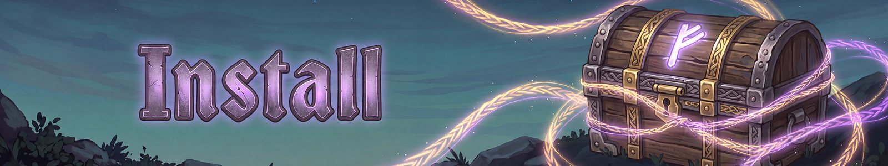

# Install
{: .visually-hidden}

Fate Woven is a Valheim mod for the Steam version of the game. It is in beta, so back up your characters and worlds first (the saves are in Valheim's saves folder, under characters_local and worlds_local).

## What you need
- Valheim on Steam.
- BepInEx and Jotunn. A mod manager installs both for you.
- The same Fate Woven version as everyone you play with. A different version will not join.

## Get it
- **Hexium:** [Fate Woven on Hexium](https://valheim.hexium.gg/mods/processq/FateWoven).
- **GitHub:** every beta zip is on the [releases page](https://github.com/processq/valheim-wildcard/releases).

## With a mod manager (easiest)
Install Fate Woven from your mod manager (r2modman or similar). It brings BepInEx and Jotunn with it. Start the game from the manager.

## By hand
1. Put BepInExPack_Valheim and Jotunn in place first.
2. Copy the `plugins/FateWoven` folder from the download into `BepInEx/plugins`.
3. Start the game once. The config file is created at `BepInEx/config/FateWoven.cfg`.

## Your first minutes
Fight. Every kill gives XP, and every level offers three cards: pick one. Press **K** for the Runes panel, **Z** to cast, hold **B** for the ability wheel. The [Getting started](getting-started.md) page explains the rest. Tips from the raven are off by default; turn them on in [Settings](settings.md) if you want them.

## Updating
Install the new version over the old one, or let your mod manager update it. Everyone in a game needs the same version, so tell your group.

## Servers
Install Fate Woven on the server and on every player's PC. The host's settings apply to everyone, and a player with different card data cannot join. See [Settings](settings.md) and [Interface and multiplayer](interface-and-multiplayer.md).

## Something wrong?
See [Questions and answers](faq.md), or report it on the [issues page](https://github.com/processq/fate-woven-issues/issues/new/choose). Set **General > Logging** to Detailed and attach `BepInEx/LogOutput.log`.

---
*Fate Woven is designed by a human, who decides what it does and how it plays. The code is written by Claude, an AI model made by Anthropic, working from that design. The documentation is written by Claude too, and the icons are AI-generated.*
