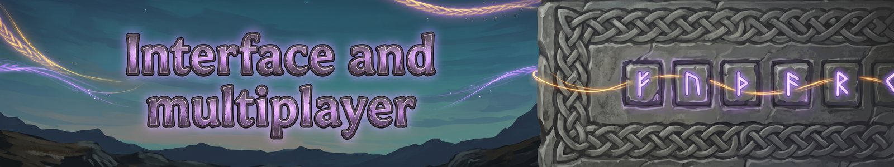

# Interface and multiplayer
{: .visually-hidden}

### Interface

With your inventory open, hold Shift and drag the ability bar or the pet window to move them. Your stance, Imbue and other lasting effects show with your other status effects. Shift and the mouse wheel resizes them, and Shift and double-click puts one back. Click the thin XP line under the bar to show numbers, a percent or nothing. Hover over an ability or buff to read about it.

### Multiplayer

Everyone in a group needs the same Fate Woven version. The host's settings apply to everyone.

### Windows

Every Fate Woven window can be moved and resized. The ability wheel stays centred. When SeneaL UI or JatifyUI is installed, our windows take on its look. With JatifyUI, Fate Woven is one panel in Jatify's spot, with Jatify's header and tabs; our windows take the look of Jatify's Crafting page, and a Fate Woven button opens the panel. Blessings are in the panel too. With SeneaL UI, the party window and frame, the board buttons and the altar prompt use its look too.

### Parties

Press **P** (or **O** with Path of Valheiman) to open the Party window. See [Party](party.md). A server's rules are in Settings under Server rules (see [Settings](settings.md)).

---
*Fate Woven is designed by a human, who decides what it does and how it plays. The code is written by Claude, an AI model made by Anthropic, working from that design. The documentation is written by Claude too, and the icons are AI-generated.*
