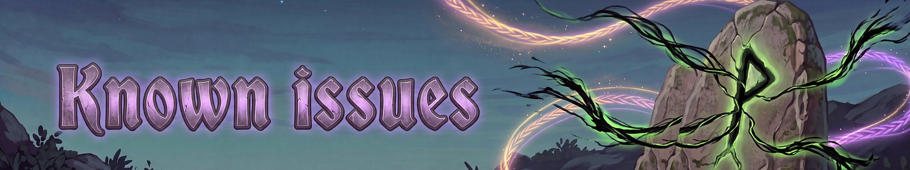

# Known issues
{: .visually-hidden}

Fate Woven is in beta and changes fast, so here is what we know is not finished or not tested yet. If you hit any of these, or something not listed, please tell us on the [issues page](https://github.com/processq/fate-woven-issues/issues/new/choose) or on Discord. Set General > Logging to Detailed first and attach `BepInEx/LogOutput.log`.

## Built, but not fully tested yet
- **Co-op effects on other players.** Tested with two players: Ash Veil, Fading Veil, Song Beneath the Shield and the one-song limit. Not yet tested with two players: Raven Banner, The Great Sea-Wall, Muster of the Slain, Bridge of Light, Steel-Sworn Rune, Yggdrasil's Cycle, Grove-Keeper's Vow, Leap of the Winds carrying others, Harvest-Lord's Step and Gallows-Speech. Steam Veil's second copy protecting other players from ranged hits is untested too.
- **New rune set pieces.** Bat Wing, Charred Relic, Growth Tar and Charred Bone are tested. Not yet: Neck Scale, Shaman's Herb, Leech Tooth, Wolf Fang, Abomination Root, Serpent Fin, Forge Slag, Valkyrie Feather and the Ember Ash and Bloodsworn 5-piece bonuses.
- **Legendary rune fixes.** Not yet tested: Void Rift on enemies that can't be staggered, Web of Fate's tie rule, Giant's Guile's strength, Iron Ledger out of combat, Grove-Keeper's Vow's pet distance, Witch's Familiar keeping its range, Wolf-Warrior Bond's fear immunity and Spell Pair copies.
- **Epic rune second copies.** Checked in testing, not yet in normal play: Totem Vessel, Black Ice, Eruption, Ward-Breaker Blow, Skyward Arc, Drowsing Field and Rampart of Spite. Shield-Loosed's second copy and Running Draw's three-arrow fan fire, but their strength isn't checked.
- **Hel's Leech.** Not yet tested: what happens when an enemy kills a leech, and hitting from behind an enemy that is already Bleeding.
- **Thrown Voice.** Tested with Shout from a totem. Songs and Nova cast from a summon are untested.
- **Raven Banner and Song Beneath the Shield.** Burning and poison ticks are meant not to get their bonus (only real hits). Not yet checked.
- **Crossbows as bows.** Snowfield Glide works. Yew-Hall Draw's faster crossbow reload isn't confirmed.
- **Old saves.** Characters with cards that have since been cut or renamed (Carried Threads, Full Sets, blessing offers) are handled, but haven't been tried with a real old save. Back up your character first.

## Rough edges
- **Hearth Shelter:** at night the walls keep the same faint glow instead of darkening. The fire is mostly purple with a little orange showing through. With the fade-in switched off, a rune panel can flash for one frame.
- **Hel's Leech** is hard to trigger on an enemy you have already made Bleed, because the bleeding alerts it.
- **Different versions can't join each other.** A player on an older version would also miss many of the new co-op effects, so everyone in a game must update together.
- **PvP:** with PvP on, Fate Woven still treats other players as friends, by design. Only plain weapon damage works between players.

## Mods
- **Creature Level and Loot Control 4.6.4** from Thunderstore crashes with this game version. Use version 5.x from Hexium.
- **Epic Loot** works even though it shows a "not compatible" warning.

## First-pass balance
- **XP and mastery are sped up for the beta,** so you can reach more of the game quickly. Expect levelling and mastery to be slower after the beta.
- All balance is tuned against normal enemies, not yet against levelled-up enemies from enemy mods such as Creature Level and Loot Control or Monstrum. Expect it to change.
- First numbers, likely to change: the new set pieces, the Epic second copies, Ward-Breaker Blow's rebuilt shield, the Warding Rune beam's stacking shields, Last Command's shield of 30, Reaper's Toll's 6 refunds a minute, and control on big enemies (half length, then 6 seconds of immunity).
- Effects that fire "about N times a minute" on rare events now fire as often as their cards say, so they are stronger than before.

---
*Fate Woven is designed by a human, who decides what it does and how it plays. The code is written by Claude, an AI model made by Anthropic, working from that design. The documentation is written by Claude too, and the icons are AI-generated.*
