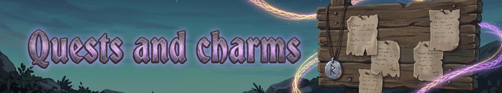

# Quests and charms
{: .visually-hidden}

## 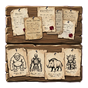 The quest board

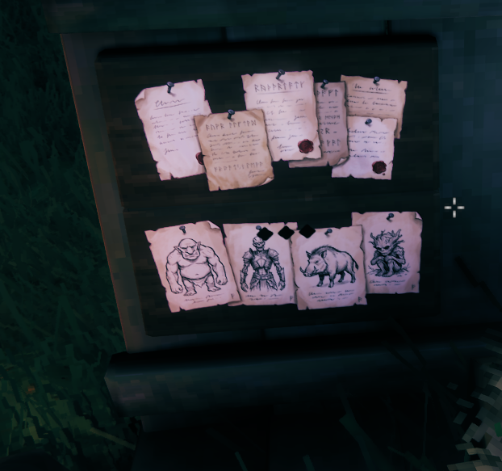
*The quest board: notices on the top board, wanted posters on the bottom.*

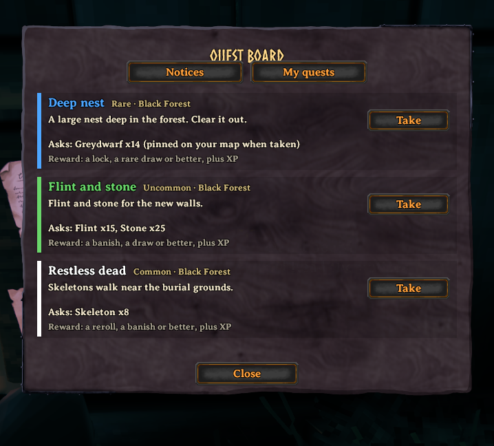
*The board window: take a notice, hand it in.*

Quests are posted on the **quest board**, a piece you build with the hammer (it needs a Hard antler from Eikthyr, 10 Wood and 5 Leather scraps, at a workbench). You can build as many as you like. Press E to read the notices.

- Each character has their own notices. A plain board shows three, and a new one appears about once an in-game day. Upgrades (below) add notices and bring them faster.
- Notices follow the Charm you wear: with no Charm you are offered Meadows notices. A notice at the tier of the Charm you hold pays its full rewards; an easier notice pays XP only, and harder ones are not offered. Your level does not decide it.
- **You see the reward before you take a notice.** It is rolled when the notice is offered and shown on it.
- Take a notice, do it, and hand it in at a board. Kill quests are handed in at a board too.
- **Group quests:** with a party, a quest one member takes is offered to the others, wherever they are (see below).

## Board ranks

You can upgrade the board with a boss drop plus a few materials from that biome. Anyone can pay at any board, you buy the ranks in order, and the best rank bought in a world applies to every board in it, for every player. A higher rank gives more notices, brings new ones sooner, tilts the notices toward rarer quests and gives you more rerolls a day.

| Rank | Boss drop | Notices | A new notice every | Rerolls a day | Also needs |
|---|---|---|---|---|---|
| Base board | Hard antler (Eikthyr), to build it | 3 | 24 hours | 1 | 10 Wood, 5 Leather scraps |
| I | Swamp key (The Elder) | 4 | 18 hours | 2 | 10 Core wood, 5 Bronze nails |
| II | Wishbone (Bonemass) | 5 | 14 hours | 2 | 10 Ancient bark, 5 Chain |
| III | Dragon tear (Moder) | 6 | 12 hours | 3 | 10 Silver, 5 Obsidian |
| IV | Torn spirit (Yagluth) | 7 | 10 hours | 3 | 10 Black metal, 5 Linen thread |
| V | Majestic carapace (The Queen) | 8 | 8 hours | 4 | 10 Yggdrasil wood, 5 Black marble |
| VI | Fader relic (Fader) | 9 | 6 hours | 4 | 10 Flametal, 5 Grausten |

**Rerolls, Decline and Abandon.** A **Reroll** swaps one notice for a fresh quest and reward at once, free. You have a few each in-game day (the table above) and they are yours alone. **Decline** clears a notice you do not want and spends a reroll to put a new one there. With no rerolls left it still clears the notice, but the slot stays empty until the next notice is due. **Abandon** drops a quest you already took: it gives you a fresh notice if you have a reroll left. Set-rune quests cannot be rerolled or declined.

## What the quests ask

There are 72 quests across the Meadows to the Ashlands: 11 Meadows, 12 Black Forest, 12 Swamp, 9 Mountains, 10 Plains, 9 Mistlands, 9 Ashlands. The kinds are: kill a creature count or one named target, gather items, deliver items, clear a nest or a dungeon, and the Legendary altar hunts below.

**Epic quests** ask you to clear a place: kill a set number of enemies at a named location, such as the Burial Chambers or the Frost Caves, 150 to 2000 m from the board. They are rarer, and they are the quests that can pay a Unique.

**Rune set quests.** Every rune set has a quest on the board that pays the set's element rune. It appears once your Charm reaches that biome and stays until you take it. You can do it once per character, and a Re-weave does not bring it back. The rune goes straight into your Runes list. See [Rune sets](sets.md).

## Legendary altar hunts

The rarest notices are hunts: a very strong boss, or a boss with a group, waiting at an altar. There is one hunt for each biome from the Meadows to the Ashlands, seven in all. **They need Creature Level and Loot Control**; without it Legendary notices are not offered.

- Take the notice and an altar is marked on your map. Make the offering there (a stack of that biome's materials) and the enemies appear.
- The boss is much tougher than a normal one. It stays at its altar, and it resets if you leave or everyone dies. Try again with a new offering.
- Only players who took the quest and are close by when the last enemy falls get the reward. As with any quest, a hunt below your Charm's tier pays XP only.
- The creatures drop their usual loot and can drop the biome's set pieces. Which boss, and what it carries, is left for you to find.

## Group quests

When a party member takes a quest, the other members are offered it, wherever they are. Everyone who accepts shares one progress count. The target grows with every extra member who joins, and each player gets their own reward roll. Members must be near the kill or place to count. This replaces the old Share button.

## Trades

Finishing a **Rare, Epic or Legendary group quest** gives each member who finishes it a chance to earn a **trade**: 15% for Rare, 30% for Epic and 60% for Legendary. Easier quests and quests done alone give none. You can bank up to 3, and a trade is spent only when you complete one. See [Party](party.md) for what a trade does.

## Rewards

Every reward has a tier, from Common to Legendary, and your notice's rarity sets the odds. Rewards include XP bundles, extra draft choices, rerolls, banishes and locks for your drafts, favour with the gods, a set's element rune, and permanent perks. Rerolls, banishes and locks come from quests only, and earning many in a short time makes the next one less likely.

There are 41 permanent Legacy Rewards. They are left for you to discover in play. Some are chains where each stage unlocks the next.

### Frayed Threads

Now and then a quest reward is a **Frayed Threads** ability: an ability of the game's choosing, called Frayed (for example Frayed Rune Bolt), with runes already locked in its slots. About one notice in twenty on the board offers one, and the notice shows which ability it is but not the runes.

- The runes are random and can be strong or weak. You can't remove or move them. The element slot is always filled. A better quest fills more slots.
- It has **20 to 50 uses** and does not recharge. At zero it is removed. It shows its uses left in your abilities list, and takes a bar slot like any ability.
- A Re-weave removes it. It can't be traded.

## Rune Charms

A Charm is a crafted item that raises the power of all your abilities. It has its own equipment slot (right-click it in your inventory to equip it). **You can hold only one Charm at a time**, and a Charm can't be dropped, stored in a chest or traded; crafting a higher one asks first before it replaces the old one. With no Charm you are at x1.00.

| Charm | Station | Recipe | Strength |
|---|---|---|---|
| 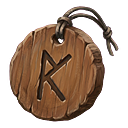 Wooden Charm | Workbench | 1 Hard antler, 2 Wood, 3 Flint | x1.75 |
| 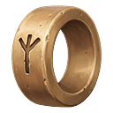 Bronze Charm | Forge | 1 Swamp key, 2 Wood, 4 Bronze, 1 Leather scraps | x2.75 |
| 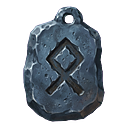 Iron Charm | Forge | 1 Wishbone, 2 Wood, 10 Iron, 1 Leather scraps | x3.75 |
| 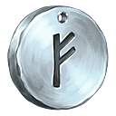 Silver Charm | Forge | 1 Dragon tear, 1 Wood, 20 Silver, 2 Leather scraps, 3 Iron | x4.75 |
| 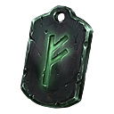 Black Metal Charm | Forge | 1 Torn spirit, 3 Finewood, 10 Black metal, 3 Linen thread | x5.75 |
| 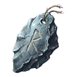 Carapace Charm | Black forge | 1 Majestic carapace, 5 Yggdrasil wood, 2 Carapace, 1 Mandible | x7.00 |
| 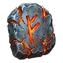 Flametal Charm | Black forge | 1 Fader relic, 5 Charred bone, 8 Flametal, 3 Sulfur, 2 Asksvin hide | x8.50 |

**A strong Charm also lifts other systems.** Besides your abilities, the Charm you wear sets how strong the Bots, the Summon and the Hidden Hall are. Wear a high Charm only when you want all of that.

The first item of each recipe is a boss drop and is needed only once. Charms upgrade like vanilla tools, up to quality 4: each level above 1 adds 5% to the Charm's strength (15% at the top), and an upgrade takes the recipe again except for its first item.

**Special Charms.** Legendary rewards can pay Elemental Charms (one element boosted) and Greater Charms (above the Flametal Charm). They are kept in a **Charms list** in the Mastery screen (or right-click the worn Charm), and you switch your Charm into a special form from there when you hold a crafted Charm of its tier. A Re-weave never loses them.

## 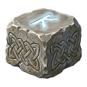 The Altar of the Gods and your Favour list

The **Altar of the Gods** (40 Stone and 10 Finewood) is where you make offerings to any of the seventeen gods. Choose a god from your Favour list, then press E to offer one item, or hold E to offer a stack. Meads, feasts, fish, trophies and a few rare materials all count, and there is no limit. The Favour list on your blessings screen shows each god's rank and how to earn more favour with them. You can swap a blessing there too.

---
*Fate Woven is designed by a human, who decides what it does and how it plays. The code is written by Claude, an AI model made by Anthropic, working from that design. The documentation is written by Claude too, and the icons are AI-generated.*
