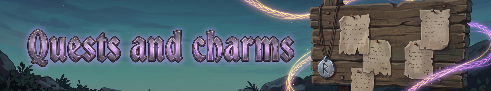

## 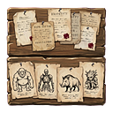 The quest board

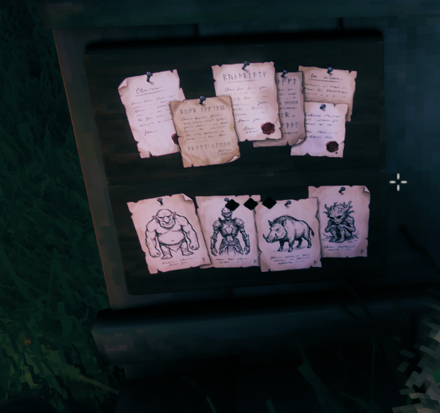
*The quest board: notices on the top board, wanted posters on the bottom.*

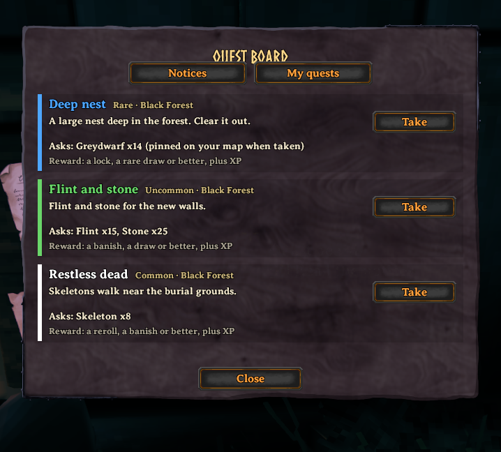
*The board window: take a notice, hand it in.*

Quests are posted on the **quest board**, a piece you build with the hammer (it needs a Hard antler from Eikthyr, 10 Wood and 5 Leather scraps, at a workbench). You can build as many as you like. Press E to read the notices.

- Each character has their own three notices at a time, and a new one appears about once an in-game day.
- A notice's biome follows your world: it is the biome after the highest boss you have beaten there (Meadows before Eikthyr, the Black Forest after, and so on). Your level does not decide it.
- Take a notice, do it, and hand it in at a board. Kill quests are handed in at a board too.
- **Sharing:** press Share to offer a quest to players within about 10 m. If they accept, you share one progress count, the target grows with more people, and each player gets their own reward roll.

## What the quests ask

There are 53 quests across the Meadows to the Ashlands: 9 Meadows, 9 Black Forest, 7 Swamp, 7 Mountains, 7 Plains, 7 Mistlands, 7 Ashlands. The kinds are: kill a creature count or one named target, gather items, deliver items, and clear a nest or a dungeon.

## Rewards

Every reward has a tier, from Common to Legendary, and your notice's rarity sets the odds. Rewards include XP bundles, extra draft choices, rerolls, banishes and locks for your drafts, favour with the gods, blessings, tokens, and permanent perks.

There are 44 permanent Unique rewards. They are left for you to discover in play. Some are chains where each stage unlocks the next.

> **More to come: Legendary quests**
> The rarest notices send you to call a named boss at an altar with an offering.
> Which boss, and what it carries, is left for you to find.

## Rune Charms

A Charm is a crafted item that raises the power of all your abilities. It has its own equipment slot (right-click it in your inventory to equip it), and you can wear one at a time. With no Charm you are at x1.00.

| Charm | Station | Recipe | Strength |
|---|---|---|---|
| 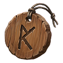 Wooden Charm | Workbench | 1 Hard antler, 2 Wood, 3 Flint | x1.75 |
| 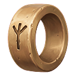 Bronze Charm | Forge | 1 Swamp key, 2 Wood, 4 Bronze, 1 Leather scraps | x2.75 |
| 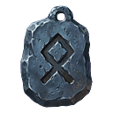 Iron Charm | Forge | 1 Wishbone, 2 Wood, 10 Iron, 1 Leather scraps | x3.75 |
| 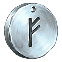 Silver Charm | Forge | 1 Dragon tear, 1 Wood, 20 Silver, 2 Leather scraps, 3 Iron | x4.75 |
| 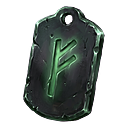 Black Metal Charm | Forge | 1 Torn spirit, 3 Finewood, 10 Black metal, 3 Linen thread | x5.75 |
| 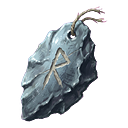 Carapace Charm | Black forge | 1 Majestic carapace, 5 Yggdrasil wood, 2 Carapace, 1 Mandible | x7.00 |
| 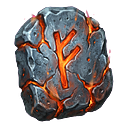 Flametal Charm | Black forge | 1 Fader relic, 5 Charred bone, 8 Flametal, 3 Sulfur, 2 Asksvin hide | x8.50 |

The first item of each recipe is a boss drop and is needed only once. Charms upgrade like vanilla tools, up to quality 4: each level above 1 adds 5% to the Charm's strength (15% at the top), and an upgrade takes the recipe again except for its first item.

> **More to come: Elemental and Greater Charms**
> Legendary quests can pay Charms tuned to one element, and Greater Charms that go beyond the Flametal Charm.
> They cannot be crafted.

## 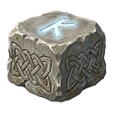 The Altar of the Gods and your Favour list

The **Altar of the Gods** (40 Stone and 10 Finewood) is where you make offerings to any of the seventeen gods. Choose a god from your Favour list, then press E to offer one item, or hold E to offer a stack. Meads, feasts, fish, trophies and a few rare materials all count, and there is no limit. The Favour list on your blessings screen shows each god's rank and how to earn more favour with them. You can swap a blessing there too.

---
*Fate Woven is designed by a human, who decides what it does and how it plays. The code is written by Claude, an AI model made by Anthropic, working from that design. The documentation is written by Claude too, and the icons are AI-generated.*
