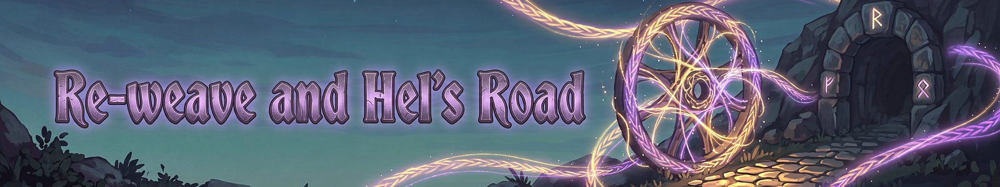

# Re-weave and Hel's Road
{: .visually-hidden}

## Re-weave

At level 60 the Runes panel offers a **Re-weave**: the Re-weave starts you over, and a confirm screen shows exactly what you keep and what resets.

- **You keep:** your world, gear, vanilla skills, favour, special Charms, your Legacy Rewards, every rune set piece, any trades you have banked and the boss-trophy signatures.
- **You start over:** your level, abilities, runes, mastery, blessings and quests. Frayed abilities are removed. Your crafted Charm is deleted, your pets are dismissed, and you go back to the main menu.
- **You gain Carried Threads.** Pick one ability and one rune on the Re-weave screen. They wait in a second window under your draft, called **Carried Threads**, once your level reaches their tier. You still make just one pick, and anything you pass over stays there for your next draft of that kind. You can hold ten of each, and after that a new Thread lets you swap one you hold.
- **Your rerolls refill.** Rerolls, banishes and locks each have a maximum and a current count, and a Re-weave sets the current back to the maximum. Banished cards come back.

## Undo

Changed your mind? An **Undo last Re-weave** button in the Settings panel brings the old character back until you reach level 5 of the new run. Undo is on during the beta, and servers can switch it off.

What comes back, in plain words: your old level, abilities, runes, mastery, favour, boss kills and tips come back from the old run. Things you earned in the new run stay with you: rune set pieces, your special Charms and your Legacy Rewards. Frayed abilities come back too.

## Redo my picks

The draft schedule changed (an ability every third level, runes in between), so a character made before that change can **redo its picks once**. The button sits in the Runes panel next to Re-weave. New characters do not get it, and a server can switch it off.

- **What happens:** your abilities, runes and bar are cleared, and you pick again for every level up to your current one, on the new schedule. A summoned pet is dismissed.
- **You keep:** your level, signatures, mastery, quests, favour, blessings, Charms, boss and trophy rune choices, set pieces, rune drafts from quests and Frayed abilities (with their uses left). Each ability gets its mastery back when you pick it again.
- **Runes you earned from quests and other finds** are not lost: you get extra rune drafts to make up the difference.
- **Undo:** a backup is made first, and you can undo the redo until your next level-up. Once you have redone your picks, you cannot do it a second time, even after an undo.

## Hel's Road

**Hel's Road** is an optional hardcore Re-weave. On the Re-weave screen you can tick 'Walk Hel's Road': you get one life. If something kills you, you drop out of Hel's Road and your run carries on as normal, so you only lose the bonus. Finish level 60 without being killed and you earn a **permanent +10% XP** that carries into every later run and stacks with each Hel's Road you finish. While you walk it, quest rewards roll one tier higher.

Servers choose which deaths end it: Easy (only a kill by a creature, boss or player) or Hardcore (any death).

---
*Fate Woven is designed by a human, who decides what it does and how it plays. The code is written by Claude, an AI model made by Anthropic, working from that design. The documentation is written by Claude too, and the icons are AI-generated.*
