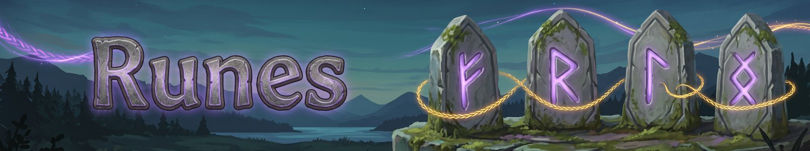

# Runes
{: .visually-hidden}

Each ability has an element slot, a few normal slots, an Epic slot and a Legendary slot. Runes of the same element stack: about +20% in a normal slot, +25% in the Epic slot and +30% in the Legendary slot. Epic and Legendary runes also change how an ability plays, and they break an enemy's resistance to their element for a few seconds.

Rune slots: one **element** slot, a few **normal** slots, one **Epic** slot and one **Legendary** slot. Runes of the same element stack.

There are 163 Epic and Legendary runes. They are left for you to discover in play.

> **More to come: Epic and Legendary runes**
> Epic runes reshape what an ability does: a bolt that splits, a heal that pulses, a strike that spins.
> Legendary runes bend the rules of a build and can combine two elements.
> Boss trophies, rare drops and the gods' favour lead to them. Which rune goes with which ability is up to you to find.
> Sworn runes tie an element to a god. Meta runes change how other runes work. Look for both.

## Common runes (6)

### 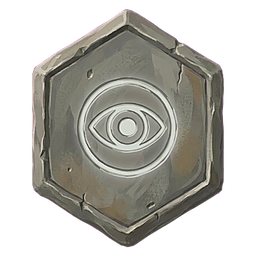 Foe-Reader

Your first hit on a foe shows what it resists and what it's weak to.

### 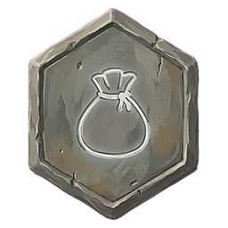 Frugal

The ability costs 15% less.

### 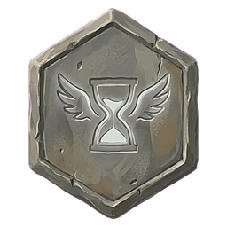 Haste

The ability cools down 12% faster.

### 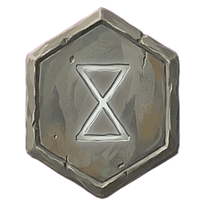 Lingering

Effects last 20% longer.

### 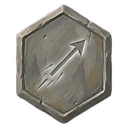 Reach

Reaches farther: longer melee reach, faster and farther projectiles, longer beams and moves.

### 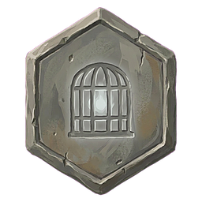 Wisplight Rune

Lights up the area and reveals hidden foes.

## Uncommon runes (14)

### 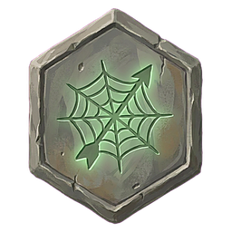 Arrow-Catcher

Your zones slow enemy projectiles, and your shields block them.

### 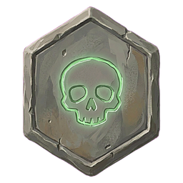 Battle-Fed

Each kill made under its effect makes the effect last longer.

### 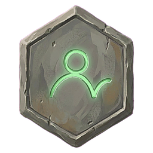 Bounce

After hitting, it hops on to one more target nearby. The effect is shared.

### 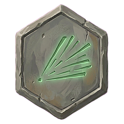 Cone

Hits everything in a cone in front of you instead.

### 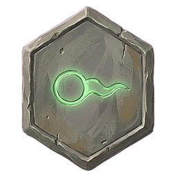 Drifting

The projectile flies much slower but lasts much longer, hitting everything it passes.

### 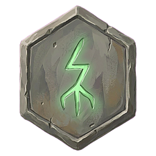 Fork

On hit, it branches to two more targets nearby. The effect is shared.

### 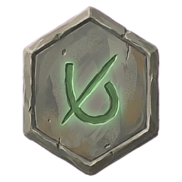 Hamstring

Hits from behind slow the foe.

### 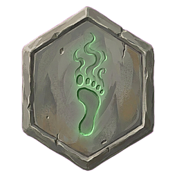 Shade Step

After the move you're stealthed, and nearby foes lose track of you.

### 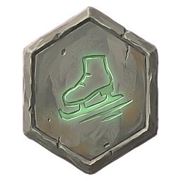 Skating Ground

You and your allies move faster and dodge farther in the zone.

### 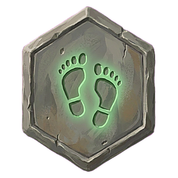 Steady Footwork

Dodging doesn't break your weapon combo.

### 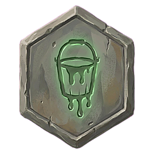 Tar Pitch

Hits tar the foe: it's slowed and weak to Fire.

### 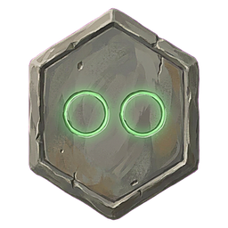 Twin Cast

Makes two of whatever the ability makes, each a bit weaker.

### 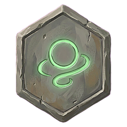 Wild Path

Spell projectiles fly a random path but hit much harder.

### 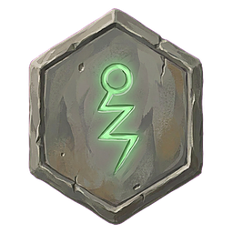 Zigzag

Spell projectiles weave as they fly and hit a bit harder.

## Rare runes (20)

### 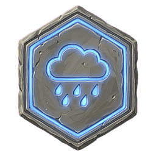 Downpour

The effect falls as rain on an area for a few seconds.

### 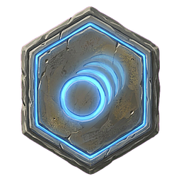 Echo

Repeats the cast 1 second later at full strength, for free.

### 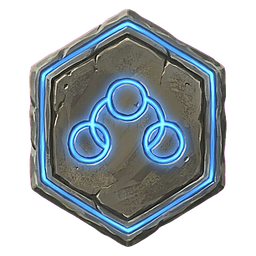 Flowing Chain

Casting it doesn't break your weapon combo.

### 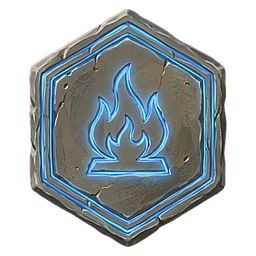 Hearth-Warmth

Cleanses every harmful status from every player it touches, and keeps cold and wet off them for a while.

### 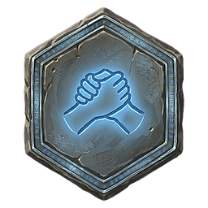 Kinship

Its effect also reaches all your summons and totems.

### 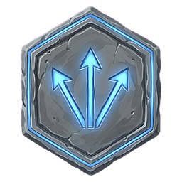 Multistrike

Adds two extra strikes or arrows. The effect is shared.

### 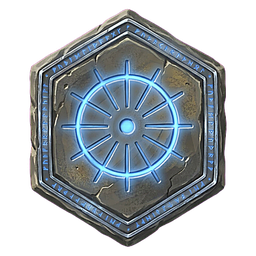 Nova

Hits everything in a ring around you instead.

### 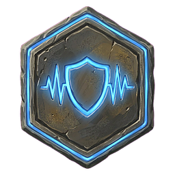 Parry Rhythm

For a few seconds, blocks and parries count as combo hits.

### 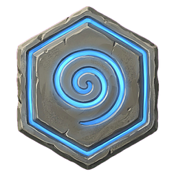 Pull

Drags foes toward its centre. Bosses don't move.

### 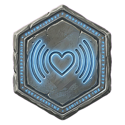 Pulsing

Its effect repeats on the same target a few more times, weaker.

### 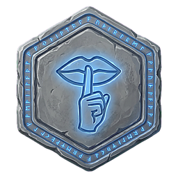 Quiet Casting

Casts are silent and don't break your stealth unless they deal damage.

### 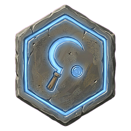 Reaper's Toll

Kills refund its cost and reset its cooldown.

### 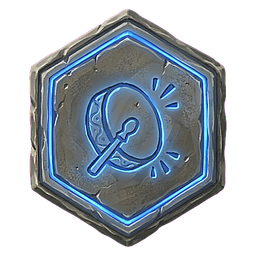 Rhythm

Each three-hit combo you finish reduces the cooldown and cost of this ability.

### 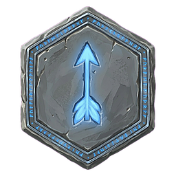 Silent Fletching

Shots are silent; foes hit from stealth don't know where it came from.

### 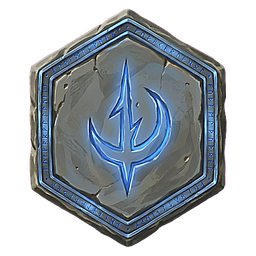 Sleep-Thorn

Its control puts the foe to sleep instead: twice as long, but any damage wakes it.

### 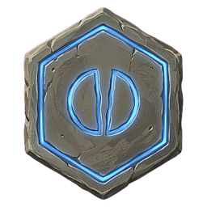 Split

When it ends, it splits into two smaller copies at 40% strength.

### 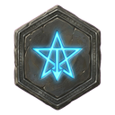 Starbane

More damage for each star on the target.

### 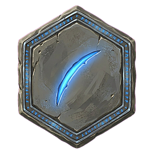 Sweeping Third

As the third hit of a combo, it also sweeps an arc in front of you.

### 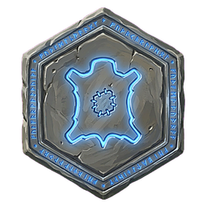 Tempered Hide

You take less damage from every hit.

### 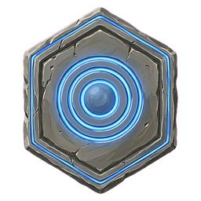 Wide

Turns a single-target ability into an area. On an area ability, the area grows.

## Meta runes (14)

### 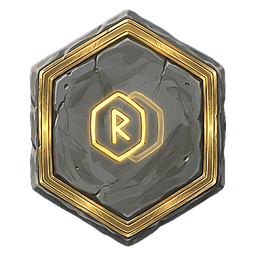 Borrowed Rune

Copies the rune in the slot to its left.

### 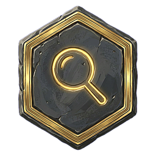 Focus

The Legendary rune on this ability counts twice, but the normal slots stay empty. One per character.

### 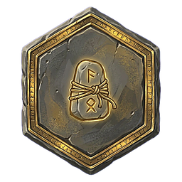 Gifted Rune

Allies under this ability's buff get its Epic rune on their own abilities. One per character.

### 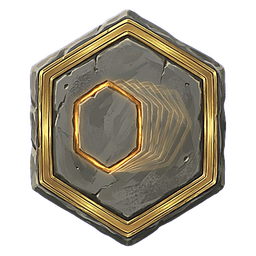 Greater Borrowed Rune

The Epic rune on this ability also works, full strength, on your other abilities. One per character.

### 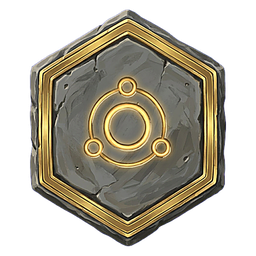 Greater Spare Socket

Gives this ability three more slots, one of them Epic.

### 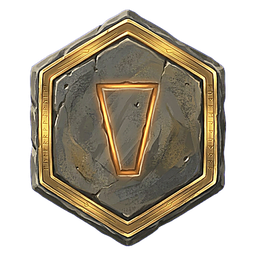 Keystone

This ability's normal slots count double. Holds nothing else.

### 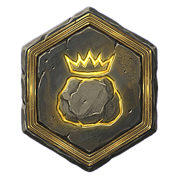 Kingstone

The abilities on each side of this one get stronger runes.

### 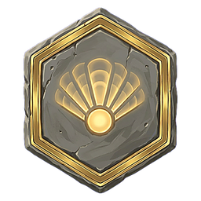 Manifold

Doubles every count on this ability: copies, pieces, branches, hops, strikes and echoes.

### 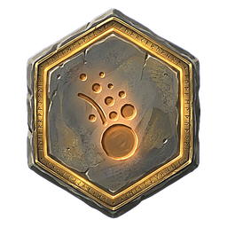 One of Many

Extra summons merge into one bigger, stronger summon.

###  Pack Runes

Your summons' hits count as this ability's hits for its runes.

###  Second Crown

Swaps the Epic slot for a second Legendary slot.

###  Shared Sigil

The Epic rune on this ability also works on your other abilities. Fills the normal slots. One per character.

###  Spare Socket

Gives this ability two more normal slots.

###  Unbroken

Extra copies and chains on this ability don't get weaker.

*The Runes panel.*

---
*Fate Woven is designed by a human, who decides what it does and how it plays. The code is written by Claude, an AI model made by Anthropic, working from that design. The documentation is written by Claude too, and the icons are AI-generated.*
