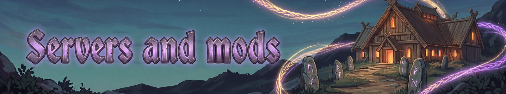

# Servers and mods
{: .visually-hidden}

For server hosts and other mod users.

- [Settings](settings.md): every setting that matters.
- [Interface and multiplayer](interface-and-multiplayer.md): the windows, and how it plays online.
- [Companion mods](companion-mods.md): what works with Fate Woven.
- [For mod authors](for-mod-authors.md): content packs and the code API.

---
*Fate Woven is designed by a human, who decides what it does and how it plays. The code is written by Claude, an AI model made by Anthropic, working from that design. The documentation is written by Claude too, and the icons are AI-generated.*
