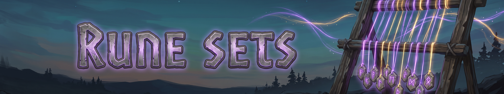

> **More to come: Set bonuses**
> Wear more pieces of a set and the set bonuses unlock. Full-set bonuses are held back for you to discover.

Rune sets give bonuses when you carry several pieces of one set. Set pieces drop from specific enemies and bosses.

## Stag-Thunder (Lightning, Meadows)

**Stag Rune** (element rune): Shocked enemies are also Staggered by your next hit. *Source: Trader quest in the Meadows.*

- **Antler Tine** (normal slot): Shocked from this ability arcs to 1 extra enemy when it is used up. *Source: 2-star Deer; the legendary quest boss of the Meadows (10%).*
- **Boar Bristle** (normal slot): Shocked lasts 1s longer. *Source: 2-star Boar; the legendary quest boss of the Meadows (10%).*
- **Neck Scale** (normal slot): +5% move speed while a Shocked enemy is within 10m. *Source: 2-star Neck; the legendary quest boss of the Meadows (10%).*
- **Stag's Leap** (Epic slot): to be discovered. *Source: Eikthyr; the legendary quest boss of the Meadows (5%).*
- **Eikthyr's Crown** (Legendary slot): to be discovered. *Source: Eikthyr; the legendary quest boss of the Meadows (2%).*

## Greydwarf Grove (Nature, Black Forest)

**Root Rune** (element rune): When a Root from this ability ends, the enemy is Slowed 30% for 2s. *Source: Trader quest in the Black Forest.*

- **Greydwarf Bark** (normal slot): Root lasts 1s longer. *Source: Burial Chambers; the legendary quest boss of the Black Forest (10%).*
- **Shaman's Herb** (normal slot): You heal 1 HP a second while an enemy you Rooted is within 10m. *Source: Greydwarf Shaman; the legendary quest boss of the Black Forest (10%).*
- **Troll Sinew** (normal slot): Roots from this ability also catch 1 more enemy within 3m (the spread doesn't spread again). *Source: Troll; the legendary quest boss of the Black Forest (10%).*
- **Troll Hide** (Epic slot): to be discovered. *Source: The Elder; the legendary quest boss of the Black Forest (5%).*
- **Elder's Heart** (Legendary slot): to be discovered. *Source: The Elder; the legendary quest boss of the Black Forest (2%).*

## Bog Rot (Poison, Swamp)

**Ooze Rune** (element rune): Venom stacks to 15 instead of 10. *Source: Trader quest in the Swamp.*

- **Leech Tooth** (normal slot): +1 Venom per hit. *Source: Sunken Crypts; the legendary quest boss of the Swamp (10%).*
- **Wraith Shroud** (normal slot): Venom lasts 2s longer. *Source: Wraith; the legendary quest boss of the Swamp (10%).*
- **Abomination Root** (normal slot): Each Venom stack also cuts the enemy's healing by a further 2%. *Source: Abomination; the legendary quest boss of the Swamp (10%).*
- **Draugr Rot** (Epic slot): to be discovered. *Source: Bonemass; the legendary quest boss of the Swamp (5%).*
- **Bonemass's Gift** (Legendary slot): to be discovered. *Source: Bonemass; the legendary quest boss of the Swamp (2%).*

## Drake's Winter (Frost, Mountains)

**Drake Rune** (element rune): When Frozen from this ability ends, the enemy keeps 2 Chilled. *Source: Trader quest in the Mountains.*

- **Wolf Fang** (normal slot): +1 Chill per hit. *Source: Frost caves; the legendary quest boss of the Mountains (10%).*
- **Golem Crystal** (normal slot): Chilled from this ability lasts 2s longer. *Source: Stone Golem; the legendary quest boss of the Mountains (10%).*
- **Fenring Claw** (normal slot): Frozen lasts 0.5s longer. *Source: Fenring; the legendary quest boss of the Mountains (10%).*
- **Silver Edge** (Epic slot): to be discovered. *Source: Moder; the legendary quest boss of the Mountains (5%).*
- **Moder's Breath** (Legendary slot): to be discovered. *Source: Moder; the legendary quest boss of the Mountains (2%).*

## Lox Plains (Earth, Plains)

**Lox Rune** (element rune): Staggered enemies are knocked back 2m. *Source: Trader quest in the Plains.*

- **Fuling Totem** (normal slot): +15% stagger. *Source: Fuling villages; the legendary quest boss of the Plains (10%).*
- **Lox Pelt** (normal slot): +10% stagger. *Source: 2-star Lox; the legendary quest boss of the Plains (10%).*
- **Growth Tar** (normal slot): Staggered enemies move 20% slower for 2s. *Source: Growth; the legendary quest boss of the Plains (10%).*
- **Lox Horn** (Epic slot): to be discovered. *Source: Yagluth; the legendary quest boss of the Plains (5%).*
- **Yagluth's Hand** (Legendary slot): to be discovered. *Source: Yagluth; the legendary quest boss of the Plains (2%).*

## Dvergr Mist (Arcane, Mistlands)

**Dvergr Rune** (element rune): About 12 times a minute, a hit restores 3 eitr to you and every ally within 8m. *Source: Trader quest in the Mistlands.*

- **Seeker Chitin** (normal slot): +5% eitr regen while slotted. *Source: Infested Mines; the legendary quest boss of the Mistlands (10%).*
- **Gjall Sac** (normal slot): Kills with this ability restore 5 eitr. *Source: Gjall; the legendary quest boss of the Mistlands (10%).*
- **Dvergr Rune-Shard** (normal slot): This ability costs 10% less eitr. *Source: Dvergr Mage; the legendary quest boss of the Mistlands (10%).*
- **Dvergr Lantern** (Epic slot): to be discovered. *Source: The Queen; the legendary quest boss of the Mistlands (5%).*
- **Queen's Eye** (Legendary slot): to be discovered. *Source: The Queen; the legendary quest boss of the Mistlands (2%).*

## Ember Ash (Fire, Ashlands)

**Ember Rune** (element rune): Burning stacks to 80% instead of 60%. *Source: Trader quest in the Ashlands.*

- **Charred Bone** (normal slot): Burning deals 10% more. *Source: Charred fortresses; the legendary quest boss of the Ashlands (10%).*
- **Valkyrie Feather** (normal slot): Burning lasts 1s longer. *Source: Fallen Valkyrie; the legendary quest boss of the Ashlands (10%).*
- **Morgen Ember** (normal slot): Burning from this ability adds 15% per re-application instead of 10% (still up to its cap). *Source: Morgen; the legendary quest boss of the Ashlands (10%).*
- **Asksvin Scale** (Epic slot): to be discovered. *Source: Fader; the legendary quest boss of the Ashlands (5%).*
- **Fader's Crown** (Legendary slot): to be discovered. *Source: Fader; the legendary quest boss of the Ashlands (2%).*

## Tide-Wrack (Water, Ocean)

**Wave Rune** (element rune): Wet from this ability splashes onto enemies within 3m of the target. *Source: Haldor's quest: bring 3 serpent scales.*

- **Drowned Pearl** (normal slot): Hits from this ability refresh Wet on the target to its full length. *Source: Rare catch when fishing the Ocean (about 5%).*
- **Barnacle Shell** (normal slot): Wet lasts 2s longer. *Source: Mined from a Leviathan (about 5%).*
- **Serpent Fin** (normal slot): Swimming costs 10% less stamina and is 10% faster. *Source: Sea Serpents (about 5%).*
- **Serpent's Coil** (Epic slot): to be discovered. *Source: 2-star Sea Serpents (25%).*
- **Serpent King's Tooth** (Legendary slot): to be discovered. *Source: 2-star Sea Serpents (10%).*

## Night-Veil (Shadow, Swamp and Mistlands (crypts and ruins))

**Dusk Rune** (element rune): Shadow sneak attacks from this ability deal x8 instead of x6. *Source: The Bog Witch's quest.*

- **Wraith Shroud-Thread** (normal slot): Stealth from this ability lasts 1s longer. *Source: Wraiths (about 5%); the legendary quest boss of the Swamp or Mistlands (10%).*
- **Draugr Hood** (normal slot): Enemies that lose track of you search for you 2s longer before they can notice you again. *Source: Sunken Crypt chests (about 15%); the legendary quest boss of the Swamp or Mistlands (10%).*
- **Shade-Lantern Shard** (normal slot): +10% move speed while you're Stealthed. *Source: Dvergr ruin chests in the Mistlands (about 15%); the legendary quest boss of the Swamp or Mistlands (10%).*
- **Rancid Shroud** (Epic slot): to be discovered. *Source: Rancid Remains and 2-star Draugr Elites (25%); the legendary quest boss of the Swamp or Mistlands (5%).*
- **Night-Veil Crown** (Legendary slot): to be discovered. *Source: Rancid Remains and 2-star Draugr Elites (10%); the legendary quest boss of the Swamp or Mistlands (2%).*

## Bloodsworn (Blood, Swamp and Mountains)

**Blood Rune** (element rune): This ability heals you for 5% of the damage it deals to Bleeding enemies. *Source: Hildir's quest.*

- **Draugr Fang** (normal slot): Bleeding from this ability adds 15% per re-application instead of 10% (still up to 80%). *Source: Draugr (about 5%); the legendary quest boss of the Swamp or Mountains (10%).*
- **Ulv Fang** (normal slot): Bleeding lasts 1s longer. *Source: Ulvs (about 5%); the legendary quest boss of the Swamp or Mountains (10%).*
- **Bat Wing** (normal slot): Hits heal you for 2% of the damage dealt. *Source: Frost-cave bats (about 5%); the legendary quest boss of the Swamp or Mountains (10%).*
- **Elite's Blood-Torc** (Epic slot): to be discovered. *Source: 2-star Draugr Elites and the frost-cave Cultist (25%); the legendary quest boss of the Swamp or Mountains (5%).*
- **Cultist's Heart** (Legendary slot): to be discovered. *Source: 2-star Draugr Elites and the frost-cave Cultist (10%); the legendary quest boss of the Swamp or Mountains (2%).*

## Ironforged (Steel, Plains and Mistlands (Fuling villages and Dvergr forges))

**Anvil Rune** (element rune): This ability's hits ignore 10% of the target's physical resistance. *Source: Haldor's quest: bring 10 black metal scrap.*

- **Fuling Blade-Chip** (normal slot): Enemies this ability Staggers also take Steel's light Bleeding. *Source: Fuling Berserkers (about 5%); the legendary quest boss of the Plains or Mistlands (10%).*
- **Dvergr Rivet** (normal slot): Bleeding lasts 1s longer. *Source: Dvergr Rogues (about 5%); the legendary quest boss of the Plains or Mistlands (10%).*
- **Forge Slag** (normal slot): +10% stagger damage. *Source: Fuling village chests (about 15%); the legendary quest boss of the Plains or Mistlands (10%).*
- **Berserker's Iron Band** (Epic slot): to be discovered. *Source: 2-star Fuling Berserkers and 2-star Fuling Shamans (25%); the legendary quest boss of the Plains or Mistlands (5%).*
- **Shaman's Forge-Crown** (Legendary slot): to be discovered. *Source: 2-star Fuling Berserkers and 2-star Fuling Shamans (10%); the legendary quest boss of the Plains or Mistlands (2%).*

## Valhalla's Light (Holy, Black Forest, Swamp and Ashlands (the undead))

**Dawn Rune** (element rune): Marked from this ability spreads to 1 enemy within 5m when it lands (the spread doesn't spread again). *Source: Hildir's quest.*

- **Grave-Light Bone** (normal slot): Allies hitting an enemy Marked by this ability heal 3% of the damage dealt instead of 2%. *Source: Burial Chamber skeletons (about 5%); the legendary quest boss of the Black Forest, Swamp or Ashlands (10%).*
- **Draugr Ward-Stone** (normal slot): Marked lasts 1s longer. *Source: Draugr (about 5%); the legendary quest boss of the Black Forest, Swamp or Ashlands (10%).*
- **Charred Relic** (normal slot): +15% damage to undead. *Source: Charred warriors in the Ashlands (about 5%); the legendary quest boss of the Black Forest, Swamp or Ashlands (10%).*
- **Hero's Ring** (Epic slot): to be discovered. *Source: Any boss rematch (25%); the legendary quest boss of the Black Forest, Swamp or Ashlands (5%).*
- **Valkyrie's Wing** (Legendary slot): to be discovered. *Source: Any boss rematch from Moder onwards (10%); the legendary quest boss of the Black Forest, Swamp or Ashlands (2%).*

---
*Fate Woven is designed by a human, who decides what it does and how it plays. The code is written by Claude, an AI model made by Anthropic, working from that design. The documentation is written by Claude too, and the icons are AI-generated.*
