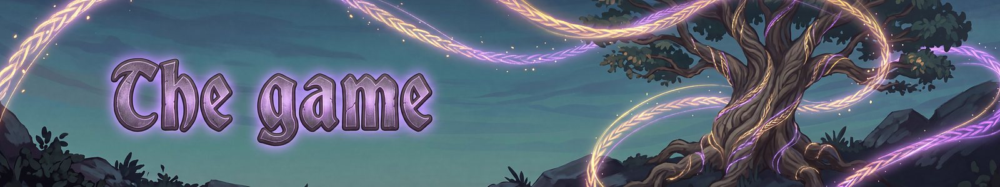

# The game
{: .visually-hidden}

How Fate Woven plays, page by page.

- [Abilities](abilities.md): every base ability, by role.
- [Runes](runes.md): how runes change abilities.
- [Elements](elements.md): the twelve elements.
- [Statuses](statuses.md): what each status does.
- [Gods and blessings](gods.md): favour and blessings.
- [Rune sets](sets.md): set bonuses by biome.
- [Utility and pets](utility-and-pets.md): summons, mounts, totems and more.
- [Quests and charms](quests-and-charms.md): the quest board and Rune Charms.
- [Re-weave and Hel's Road](re-weave.md): starting over for Carried Threads.

---
*Fate Woven is designed by a human, who decides what it does and how it plays. The code is written by Claude, an AI model made by Anthropic, working from that design. The documentation is written by Claude too, and the icons are AI-generated.*
