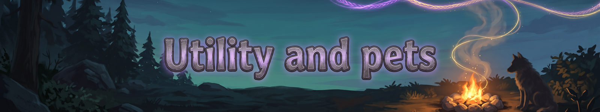
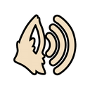
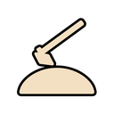
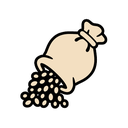
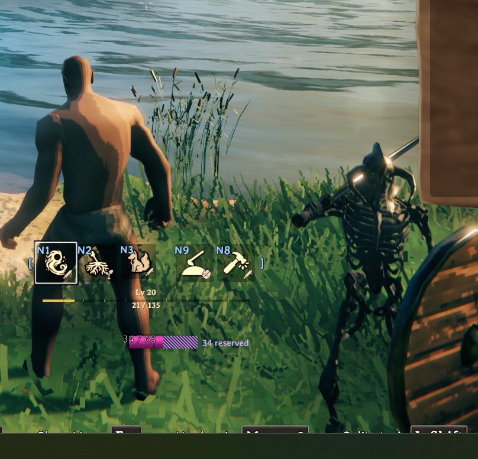
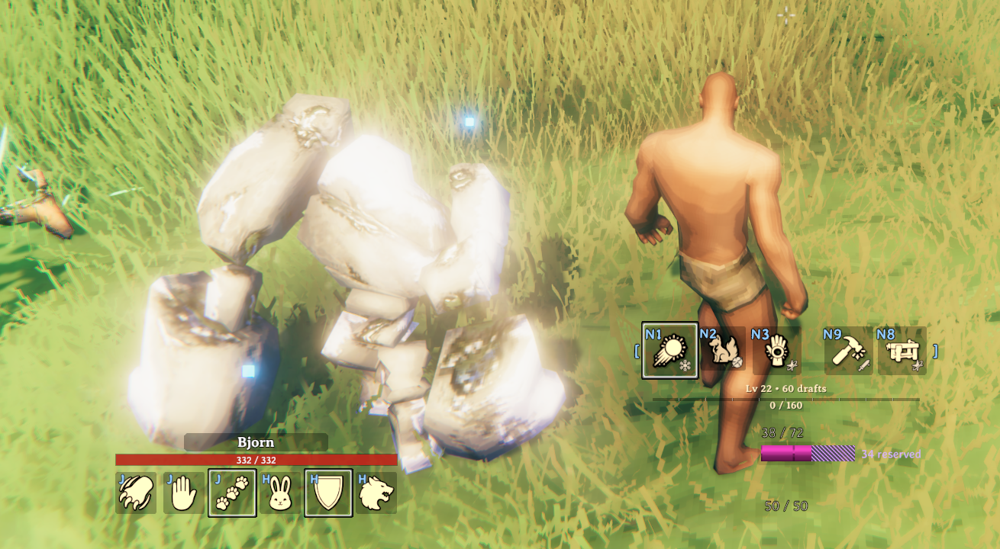
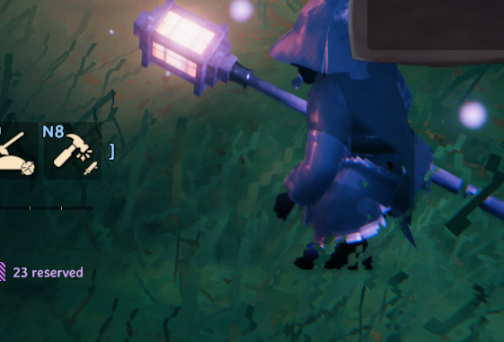

Utility abilities help you survive and travel. They never deal damage and fit only in the two utility slots.

There are 11 Epic and Legendary utility abilities. They are left for you to discover in play.

> **More to come: Utility abilities**
> Stronger utility abilities open up deeper in the game. Go and find them.

###  Beast-Speech

*Uncommon | Tamer | 0 none | 600s cooldown*

For 10 minutes you understand beasts: wild creatures show whether they're tameable, their mood and time left to tame; you can point at a spot and your tames go there and guard it; and taming within 10m goes twice as fast.

###  Bridge of Light Scaffold

*Rare | Builder | 0 none | 300s cooldown*

Place up to 20 floating steps of light, one per press, that vanish 10 minutes after the first; for climbing and building high.

###  Cook's Flame

*Rare | Hearthkeeper | 0 none | 0s cooldown*

Toggle: carry a cooking flame until you press again or die. Raw meat, fish and vegetables in your inventory cook as you go, one item every 10s, as fast as a cooking station, using no fuel. Never combat damage.

###  Earth-Shaper

*Rare | Builder | 10 stamina | 1s cooldown*

Level, raise or lower the ground in a 4m circle where you aim (up to 10m), like a hoe or pickaxe stroke over the whole circle at once.

###  Fair Wind

*Rare | Sailor | 0 none | 0s cooldown*

Toggle: the wind blows from directly behind the boat you steer, at +20% strength, until you press again, leave the boat, die or run out of eitr. Upkeep is 1 eitr every 10s. Doesn't stack with Moder's power (the stronger wins).

###  Freyr's Furrow

*Uncommon | Tamer | 10 stamina | 5s cooldown*

Plant or harvest everything in a 4m area at once (the seeds come from your inventory).

###  Herd-Call

*Common | Tamer | 0 none | 30s cooldown*

Whistle: all your tames within 100m come running to you, and any that can't find a path (stuck, across water) blink to your side; a second whistle sets them all to Stay where they are.

###  Horn of Mead

*Rare | Hearthkeeper | 0 none | 900s cooldown*

Conjure a horn of mead for you alone: drink it for 3 minutes of a small buff the element picks. It uses no potion slot and does not stack with the same effect from a real mead; it is weaker than a brewed mead by default and grows with element runes, Lingering and the slots. Never combat damage.

### Night Sight

*Rare | Survivalist | 0 none | 0s cooldown*

Toggle: until you press again or die, the dark is lighter for you only: nights, caves and dungeons are brighter and the fog is thinner, so you can see in the dark.

###  Rune-Bench

*Uncommon | Builder | 0 none | 600s cooldown*

Raise a glowing workbench for 5 minutes where you stand: it counts as a workbench for building, crafting and repairs.

###  Rune-Hearth

*Rare | Survivalist | 0 none | 600s cooldown*

Raise a rune fire pit where you aim for 5 minutes. Within 6m it keeps you warm (Cold and Freezing cannot reach you), dries you off, counts as a campfire for Comfort and Rested, and cooks raw meat and fish placed on it like a cooking station. The element changes the flame. Never combat damage.

###  Rune-Tether

*Common | Sailor | 20 stamina | 30s cooldown*

Pull a cart, boat or heavy log within 20m toward you; a beached boat slides into the nearest deep water within 10m, and a capsized one rights itself.

###  Shipwright's Hurry

*Rare | Builder | 0 none | 600s cooldown*

Instantly repair all structures and boats within 20m and every item you carry to full; for the next 60s building costs no stamina.

###  Smith's Fire

*Rare | Hearthkeeper | 0 none | 0s cooldown*

Toggle: carry a forge-flame until you press again or die. It smelts ore in your inventory into bars as you go, using coal from your inventory, one bar every 10s (as fast as a smelter).

###  Soothe the Wild

*Rare | Tamer | 0 none | 180s cooldown*

A wild tameable creature you aim at stops being hostile and won't flee for 30s, so you can feed it safely.

### Summon Mount

*Uncommon | Scout | 10 eitr | 3s cooldown*

5s channel: call a saddled Lox and climb on. It carries you until you press the ability again or it dies, and reserves 10 eitr while it is out. It never fights. If it dies, call it again once you have 10 eitr.

###  Sun Lantern

*Common | Survivalist | 0 none | 0s cooldown*

Toggle: a floating sun-light follows you until you press again or die, and burns away the Mistlands mist within 15m of you.

###  Valhalla's Feast

*Rare | Hearthkeeper | 0 none | 600s cooldown*

Set out a feast table where you aim (a short Place Feast animation, not instant). It stays for 5 minutes. Anyone who walks up and uses it (you, allies, anyone) chooses to eat: they get the dish's small buff for 5 minutes, once per table each. Its element picks the dish and the buff (Nature, the default: herb porridge, health regen of 1 a second x tier). The buff does not use a food slot and never stacks with the same buff from real food; it is weaker than a cooked meal by default and grows with element runes, Lingering and Wide and the rune slots until fully slotted it can beat one. Never combat damage.

###  Wave-Lulling Chant

*Rare | Sailor | 0 none | 900s cooldown*

For 3 minutes the waves around your boat flatten, the wind holds its direction, and storms can't capsize or damage your ship.

###  Woodsman's Fell

*Rare | Survivalist | 20 stamina | 20s cooldown*

Fell the tree you aim at, split it into logs and pull every dropped item within 15m to you, in one cast.

## Pets

*A Steel pet, a tank in polished steel, beside its owner.*

*An Earth Golem pet with its own ability bar. The hatched part of your eitr bar is held back while it is out.*

*An Arcane pet: a violet Dvergr mage with its lantern staff.*

The Summon ability calls a permanent pet. Its first element rune picks its body. Each element rune you add gives it that element's stats and abilities, unlocked at 1, 3 and 5 runes. It starts at half your height and grows as you add runes.  
Press J to order it (attack, stay, follow). Press H to set its mode (passive, defend, aggressive). Click its name in the pet window to rename it.

| Element | Role | Creature |
|---|---|---|
| Arcane | Support | Dvergr mage (support variant) |
| Blood | Healer | Blob (blood) |
| Earth | Tank | Stone Golem (earth) |
| Fire | DPS | Surtling |
| Frost | Tank | Stone Golem (ice) |
| Holy | Support | Fallen Valkyrie (golden spirit) |
| Lightning | Support | Wolf (storm spirit) |
| Nature | Healer | Greydwarf shaman |
| Poison | DPS | Blob |
| Shadow | DPS | Wraith |
| Steel | Tank | Charred Warrior (steel) |
| Water | Healer | Blob (water) |

---
*Fate Woven is designed by a human, who decides what it does and how it plays. The code is written by Claude, an AI model made by Anthropic, working from that design. The documentation is written by Claude too, and the icons are AI-generated.*
