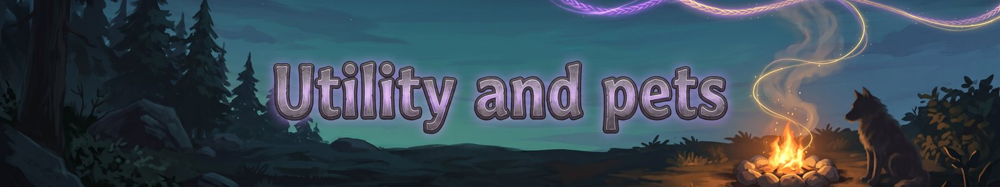
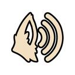
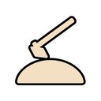
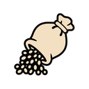
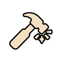
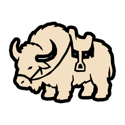
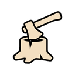
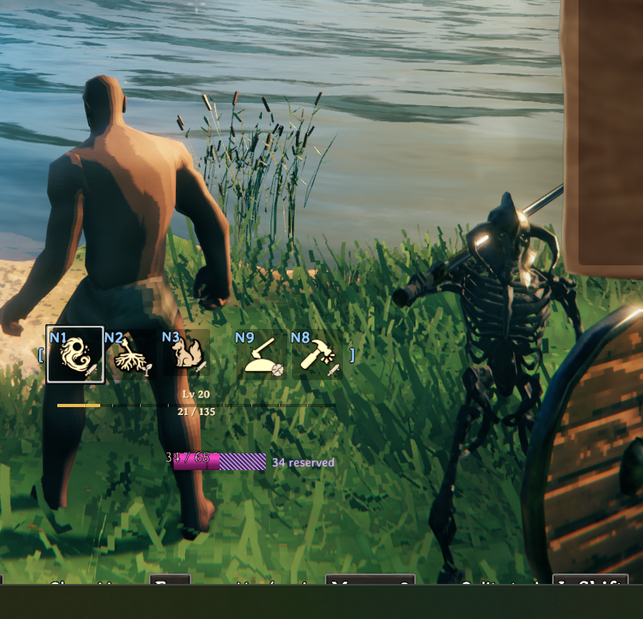
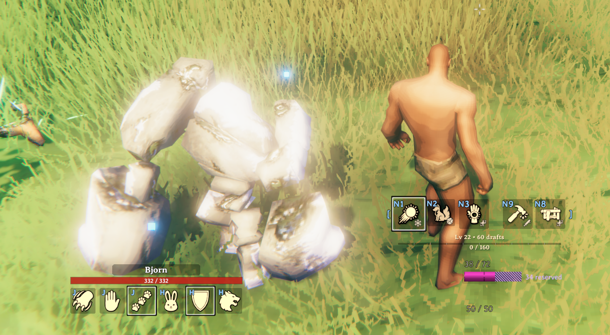
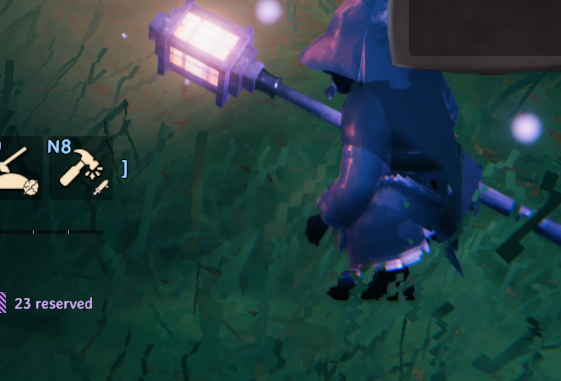

# Utility abilities and pets
{: .visually-hidden}

Utility abilities help you survive and travel. They never deal damage and fit only in the two utility slots.

There are 11 Epic and Legendary utility abilities. They are left for you to discover in play.

> **More to come: Utility abilities**
> Stronger utility abilities open up deeper in the game. Go and find them.

###  Beast-Speech

*Uncommon | Tamer | 0 none | 600s cooldown*

Shows how tameable creatures are, sends your tames to guard a spot, and speeds up taming.

###  Bridge of Light Scaffold

*Rare | Builder | 0 none | 300s cooldown*

Places floating steps of light, for climbing and building high.

###  Cook's Flame

*Rare | Hearthkeeper | 0 none | 0s cooldown*

A carried flame you toggle on: it cooks raw food in your inventory as you walk.

###  Earth-Shaper

*Rare | Builder | 10 stamina | 1s cooldown*

Levels, raises or lowers the ground in a circle where you aim.

###  Fair Wind

*Rare | Sailor | 0 none | 0s cooldown*

Toggles a wind that blows from behind your boat. Costs a little eitr to keep.

###  Freyr's Furrow

*Uncommon | Tamer | 10 stamina | 5s cooldown*

Plants or harvests a whole patch at once.

###  Herd-Call

*Common | Tamer | 0 none | 30s cooldown*

Whistles all your tames to you. Whistle again to make them stay.

###  Horn of Mead

*Rare | Hearthkeeper | 0 none | 900s cooldown*

Conjures a horn of mead for you; its element picks a small buff.

###  Night Sight

*Rare | Survivalist | 0 none | 0s cooldown*

Toggles seeing in the dark, for you only.

###  Rune-Bench

*Uncommon | Builder | 0 none | 600s cooldown*

Raises a glowing workbench where you stand for a while.

###  Rune-Hearth

*Rare | Survivalist | 0 none | 600s cooldown*

Raises a rune fire pit that warms you, dries you off and cooks meat.

###  Rune-Tether

*Common | Sailor | 20 stamina | 30s cooldown*

Pulls a cart, boat or log to you, and launches or rights boats.

###  Shipwright's Hurry

*Rare | Builder | 0 none | 600s cooldown*

Repairs nearby buildings, boats and all your gear, and building costs no stamina for a while.

###  Smith's Fire

*Rare | Hearthkeeper | 0 none | 0s cooldown*

A carried forge-flame you toggle on: it smelts the ore you carry into bars as you travel.

###  Soothe the Wild

*Rare | Tamer | 0 none | 180s cooldown*

Calms a wild creature so you can feed it safely.

###  Summon Mount

*Uncommon | Scout | 10 eitr | 3s cooldown*

Calls a saddled mount to ride. It does not fight.

###  Sun Lantern

*Common | Survivalist | 0 none | 0s cooldown*

Toggles a light that follows you and burns away the Mistlands mist.

###  Valhalla's Feast

*Rare | Hearthkeeper | 0 none | 600s cooldown*

Sets out a feast table for a few minutes; anyone who uses it gets a small buff from the element's dish.

###  Wave-Lulling Chant

*Rare | Sailor | 0 none | 900s cooldown*

Calms the sea around your boat so storms can't harm it.

###  Woodsman's Fell

*Rare | Survivalist | 20 stamina | 20s cooldown*

Fells a tree, splits it into logs and pulls in everything it dropped.

## Pets

*A Steel pet, a tank in polished steel, beside its owner.*

*An Earth Golem pet with its own ability bar. The hatched part of your eitr bar is held back while it is out.*

*An Arcane pet: a violet Dvergr mage with its lantern staff.*

The Summon ability calls a permanent pet. Your first element rune picks its body. Every element rune you add gives it that element's stats and abilities, unlocked at 1, 3 and 5 runes. It starts at half your height and grows as you add runes.  
Press J to give it orders (attack, stay, follow). Press H to set its mode (passive, defend, aggressive). Click its name in the pet window to rename it.

Pets follow their own damage curve, which is still being tuned. Healing pets (Water and Nature) do not deal damage, and their heals grow as you add runes. A caster pet no longer gets its element bonus twice.

| Element | Role | Creature |
|---|---|---|
| Arcane | Support | Dvergr mage (support variant) |
| Blood | Healer | Blob (blood) |
| Earth | Tank | Stone Golem (earth) |
| Fire | DPS | Surtling |
| Frost | Tank | Stone Golem (ice) |
| Holy | Support | Fallen Valkyrie (golden spirit) |
| Lightning | Support | Wolf (storm spirit) |
| Nature | Healer | Greydwarf shaman |
| Poison | DPS | Blob |
| Shadow | DPS | Wraith |
| Steel | Tank | Charred Warrior (steel) |
| Water | Healer | Blob (water) |

---
*Fate Woven is designed by a human, who decides what it does and how it plays. The code is written by Claude, an AI model made by Anthropic, working from that design. The documentation is written by Claude too, and the icons are AI-generated.*
