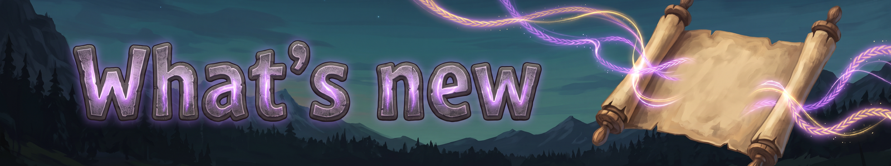

Fate Woven is in beta, and every release is listed here, newest first. Please report bugs, issues and requests on the [issues page](https://github.com/processq/fate-woven-issues/issues/new/choose).

## 0.2.1425 (beta)
- New: Elemental and Greater Charms, rewards from Legendary quests. Elemental Charms boost one element; Greater Charms go above the Flametal Charm (odds 60/30/10 for I, II and III). Their slots show the tint as a border (element colour, or gold for Greater), and the fill turns orange while worn.
- All seven pinned quest hunts now have a named elite at the pin: Grath the Troll, Vorn the Abomination, Krell the Stone Golem, Brug the Goblin Brute, Dunn the Gjall, Ashk the Morgen and Torv the Fallen Valkyrie. With CLLC installed, it rolls its own level, infusion and effect. The brute chief quest now asks for one brute.
- More blessings now work for your allies and other players, as their text says: Njord's Stillness, Brightness Returned from Hel, Apples Shared, Feast-Host, the Cauldron for others, Bristles of Gold's glow, crop growth, The High Seat and Mistletoe for allies, and Spear Flung's stamina. 18 blessings that fell short of their card were fixed.
- Ragnarok's Sentinels shows enemies as a red outline through walls. The High Seat's Watch shows a gold-white flash over the enemy's head and a chime before its attack lands.
- Chant of Many Wards and Spell-Woven Mantle work. A second aura of the same ability needs Chant of Many Wards.
- Trickster's Ante counts blessing hits, and Belt of Might Unbuckled arcs on ability hits. Youth-Apple Verses reaches allies. Thunder-Stone Ward says it rises every 30s in combat.
- Blessing hits now scale with their own element. Gjallarhorn's Warning shows an on-screen arrow. Champion's Ring and Horn at World's End work on any Shout ability.
- Fixed: Valhalla's Feast and Horn of Mead buffs arrived empty on other players' games.
- Shields are layers, each with its own timer: a short shield no longer cuts a long one short. At the cap, a new shield adds nothing.
- Summon Mount's element runes work: Lightning runs faster, Fire leaves a fire trail, Water walks on water, Nature climbs slopes up to 50% steeper, Shadow makes you harder to notice.
- Other players saw your Wolf, Bear or Raven Form as your normal self.

## 0.2.1415 (beta)
- One shape rune per ability (Cone, Nova, Beam, Downpour), one Trigger rune on your whole bar, one Path rune per ability (Drifting, Zigzag, Wild Path) and one Cost-change rune per ability (Kindred Blood, Duelist's Focus). A second one will not socket, and the socket says why. Old saves keep the first rune and grey out the second; nothing is deleted.
- Twin Cast, Split and Four Winds fit Beam. Twin Cast's beams twist round each other on one line, and beams running the same way at once twist into a helix.
- Rune combinations: about 80 cases where one rune silently cancelled another now both work (Downpour, Drifting, Beam, Wide, Twin Cast, Split, Echo, Four Winds, Borrowed Rune, Focus and Kingstone on Legendaries and more).
- Downpour works with Twin Cast (two rains side by side) and Split (a rain that ends splits into two smaller ones).
- Extra casts (Echoing Rune, Four Winds, One Voice, Ring-Giver, Totem Vessel, echo recasts) now scale their shield, hex weakening and buff share at their share. Delayed and echoed beams also scale percentage heals, buffs and stamina.
- Illusion casts no longer trigger Web of Fate (like the other trigger runes).
- A second copy of a "One per character" card shows a red "No additional effect" and does nothing (Focus counts once).
- Beams rebuilt: a beam casts without a target, straight out from your hands along the crosshair, and stops at the first enemy or wall. Steel's pierce passes it through more. Homing (Raven-Guided) bends it smoothly onto targets, Four Winds' side beams too.
- Beams are drawn as glowing round tubes, much easier to see. Wide makes a big soft tube, Twin Cast's beams run side by side, and sparks show where a beam hits.
- Heal and buff beams never affect the caster (Mending Touch, Warding Rune and Boon beams).
- Effects on wisps and Steel pets, and in Wolf, Bear and Raven Form, no longer vanish. Glows and buff sparkles no longer disappear for good.
- Ghost copies of totems and weapons show one model.
- Co-op: lasting effects (Raven Banner ravens, Dvergr Lantern, long zones) no longer vanish for other players after 2 minutes. Zone rings show their element colour to other players, and spell orbs show at their real size.
- Altar of the Gods: a rune stone laid down as the table, with a new sigil plate on top.
- With Epic Loot installed, quests can reward Epic Loot items, a choice of three items, and dust, essence and reagent bundles.
- With CLLC installed, quest elites get CLLC's own level, infusion and effect. The Old Tusker is now a named elite boar.
- The Quest board works on dedicated servers.
- Charms upgrade like vanilla tools, up to quality 4: each level adds 5% to the charm's strength. An upgrade takes the recipe again, except its first item (the boss token, needed once).
- With SeneaL UI loaded:
- With Equipment and Quick Slots or Extra Slots, the Fate Woven button bar moves under the crafting panel, so their equipment panel shows.
- Path of Valheiman: our spells keep their average strength.
- The buff row above the food icons shows only stances, Weapon Imbue and timed self-effects. Buffs and shields show once, in the normal status row.
- Timed shields fade just before they come back: Nine-Mothered Guard's shield, the Support Totem's Holy shield and Shield-Ship Crossing's shield now last a little less than the time between them.
- Hugin the raven brings Fate Woven's tips, as vanilla's tutorials do (still off by default).
- The Holy pet always claws (it could keep a taunt that never hits).
- A respawn after death no longer loses track of a pet that is still out.
- The Flametal Charm could not be made (its recipe named the wrong item).
- The Echo card's switch now works.

## 0.2.1374 (beta)
- A pale-blue shield bar sits on top of the health column while you have a shield.
- The shield bubble is faint again: a shield renewed on a timer no longer piles up extra layers until it glows bright.
- Nine-Mothered Guard's shield lasts 17s, so it fades just before the next one.
- Dropping a blessing on an active slot replaces that slot's blessing. One blessing per god still applies, and the screen says which one was replaced.
- The Arcane pet (Dvergr mage) no longer casts vanilla's shield bubble; pets only use Fate Woven's attacks.
- The Quest board window's title no longer sits behind its tabs.

## 0.2.1364 (beta)
- New: the Quest board is two boards stacked, with notices and wanted posters pinned on it.
- New icons for the Quest board and the Altar of the Gods.
- Quest notices match your world's progress: their biome is the one after the highest boss beaten in your world (Meadows before Eikthyr, then the Black Forest, and so on). Your level no longer decides it.
- Unique abilities: Summon can be in only one bar slot at a time. Extra Summons stay in your book with their own runes; drop one onto the slot to swap.
- The Runes panel updates as soon as you put a Charm on or take it off.
- A quest board takes down any notice for a biome your world hasn't reached yet and puts up new ones.

## 0.2.1354 (beta)
- Pets fight enemies within 20 m of you (it was 10 m).
- Caster pets now shoot a visible Fate Woven bolt.

## 0.2.1352 (beta)
- Pets and summons use only Fate Woven's attacks: their creature's own slams, area blasts, projectiles, statuses and knockback are gone.
- Pets, their pack copies and your mount never damage trees, rocks, ore or buildings.
- A pet you haven't named gets a random name.
- The stamina number sits under the stamina bar and the eitr number above the eitr bar, so neither covers the reserved eitr.
- The Favour list sorts gods by rank, then by progress in the rank (issue #12).
- Cooldowns over a minute show minutes, such as "4m" (issue #13).
- A utility ability's rune lines say what that rune does on that ability (issue #14).

## 0.2.1345 (beta)
- New utility ability: Summon Mount (from level 30). A 5s channel calls a saddled Lox to ride; it never fights. Element runes change it: Lightning faster, Fire a flame trail, Nature higher jumps, Shadow hidden while riding, Water faster swimming.
- The Earth pet is now a stone Golem, and Summon calls it by default.
- Every tank pet (Earth, Steel, Frost) taunts nearby enemies from its first rune.
- Pet damage evened out: tank, healer and support pets about 8 damage a second, DPS pets about 16.
- Pets only fight enemies within 10 m of you, and run a little faster than you sprint.
- The Steel pet fights with its own weapon, in steel.
- Standing near the Fire pet (Surtling) keeps you warm.
- Only the Shadow pet gets sneak attacks; other pets always hit their normal amount.
- Summon's tooltip shows the pet's own hit.
- Blessings: right-click a blessing, or drag it into the reserve window, to take it out; the reserve window has a scrollbar.
- Lists scroll with the mouse wheel or their scrollbar only, never by dragging.

## 0.2.1327 (beta)
- New pet looks: Steel is a polished-steel Charred Warrior with a sword and shield; Arcane a violet Dvergr mage in lavender robes; Nature a moss-green shaman with drifting leaves.
- The Holy Valkyrie no longer has a dark aura; the Lightning wolf is a faint spirit with lightning running through its bones; the Frost golem has an ice texture.
- Everyone in the world sees your pet's look.
- Tank pets are bigger (three-quarters of your height to start).
- Caster pets (Arcane, Water, Nature, Fire) stay back and cast instead of running in.
- Pets no longer talk.
- The eitr bar stays up while you have eitr reserved, and the reserved section lines up with it.

## 0.2.1306 (beta)
- New Epic runes: Mending Burst, Shielding Burst, Wrathful Mend, Mending Ward, Cleansing Burst and Contagion.
- Shields now stack, up to a share of your max health (a server setting, 50% by default).
- New pet looks: Holy is a golden spirit Valkyrie, Lightning a crackling storm-wolf spirit, Frost a small ice Stone Golem.
- Pets on Follow keep following, and no longer die to water or rain.
- Summon and combat toggles earn mastery in a fight and for a minute after; other toggles earn slowly while on.
- Loki's blessings Wolf-Mother's Brood and False Shapes, and his favour for enemies killed by falls, traps or each other.
- Rhythm now makes the ability's next cast cheaper instead of refunding cost.
- Settings are split into tabs. The wheel and the Next / Previous ability keys both work; the Wheel / Cycle switch is gone.
- The ability wheel is carved stone.
- Tooltips: each rune shows once with its count (x3), and runes whose effect is already in the numbers have no extra line.
- Fixed: typing E in a search box closed the inventory.

## 0.2.1288 (beta)
- Twin Cast: the bolts leave your hand together, spread evenly around your aim, and curve onto your target. A lone enemy takes every bolt.
- Spell bolts take a slightly wandering path, so several bolts are easy to tell apart.
- Changing Summon's runes while your pet is out dismisses it. Cast Summon again to call the new one.
- Summon's tooltip says what each element rune gives your pet.
- Toggle abilities (stances, Weapon Imbue, Inner Breath and the toggle utilities) earn mastery while they are on.
- The Blood and Water pets are now Blobs: a red one and a blue one.
- The Earth pet's Lox is a little smaller (you can still ride it).
- Pets on Follow keep following you.

## 0.2.1270 (beta)
- First public beta.
- Fixed: an error every frame after you left a world and loaded another one.
- Abilities that charge (Gathered Bolt and others) now show a charge meter, hold you in place while you charge, and play a casting pose.
- Cooldowns show a large countdown number on the ability icon.
- Ground markers (Downpour and others) are now carved rune circles that follow the ground.
- Tooltips are shorter: they show the current numbers, and the runes you socket change them.
- New: Quests, Charms, the Favour list and the God Altar.

---
*Fate Woven is designed by a human, who decides what it does and how it plays. The code is written by Claude, an AI model made by Anthropic, working from that design. The documentation is written by Claude too, and the icons are AI-generated.*
